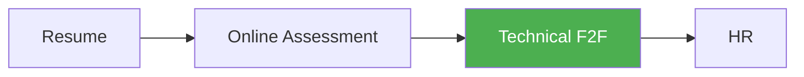

# CSE Fundamentals — Interview Quick Revision

 
> Designed for last-minute revision — not a textbook. Pseudocode in DSA files; runnable Python in [solutions-python.md](md/solutions-python.md).

---

## For Students — Start Here

| Step | Action | File |
|------|--------|------|
| 1 | Understand interview flow | [interview-overview.md](md/interview-overview.md) |
| 2 | Learn interview etiquette | [interview-tips.md](md/interview-tips.md) |
| 3 | Revise topics (checklist below) | `md/` folder |
| 4 | Solve P1 problems | [practice-problems.md](md/practice-problems.md) |
| 5 | Check solutions after attempting | [solutions-python.md](md/solutions-python.md) |
| 6 | Run 45-min self-mock | [mock-interview-pack.md](md/mock-interview-pack.md) |
| 7 | Practice scenario questions | [scenario-questions.md](md/scenario-questions.md) |

### 1-Week Prep (F2F scheduled)

| Day | Focus |
|-----|-------|
| 1 | [interview-tips](md/interview-tips.md) + [complexity-analysis](md/complexity-analysis.md) |
| 2 | [strings](md/dsa-strings.md) + [arrays](md/dsa-arrays-hashmaps.md) + solve #1–10 |
| 3 | [greedy](md/dsa-greedy.md) + [stacks](md/dsa-stacks-queues.md) + solve #11–20 |
| 4 | [DBMS](md/dbms-sql.md) + [OS](md/operating-systems.md) |
| 5 | [CN](md/computer-networks.md) + [security](md/network-security-basics.md) + [scenarios](md/scenario-questions.md) |
| 6 | [mock-interview-pack](md/mock-interview-pack.md) timed |
| 7 | [projects-resume](md/projects-resume.md) + [language-essentials](md/language-essentials.md) |

### 2-Week Prep (Full cycle: OA → F2F → HR)

| Week | Focus |
|------|-------|
| **Week 1** | [OA prep](md/oa-preparation.md) + P1 coding + [COA basics](md/coa-basics.md) |
| **Week 2** | CS fundamentals + [advanced-dsa](md/advanced-dsa.md) + 2 mocks |

---

## For Trainers — Start Here

| Step | Action | File |
|------|--------|------|
| 1 | **Read this first** — full trainer guide | **[TRAINER.md](TRAINER.md)** |
| 2 | 15-min pre-session checklist | TRAINER.md §7 |
| 3 | Pick coding + SQL + fundamentals | TRAINER.md §2–4 |
| 4 | Scenario questions for discussion | [scenario-questions.md](md/scenario-questions.md) |
| 5 | Verify student code against reference | [solutions-python.md](md/solutions-python.md) |
| 6 | Score with rubric + feedback template | TRAINER.md §6 |
| 7 | Assign student self-mock | [mock-interview-pack.md](md/mock-interview-pack.md) |

### 6-Hour Training Day Plan

See [TRAINER.md § Format D](TRAINER.md) — lecture + mocks + scenario practice.

---

## Self-Assessment Checklist

Score: ✅ confident · ⚠️ revise · ❌ not started

| Area | File |
|------|------|
| ⬜ Interview process & tips | [interview-overview](md/interview-overview.md), [interview-tips](md/interview-tips.md) |
| ⬜ Complexity / Big-O | [complexity-analysis](md/complexity-analysis.md) |
| ⬜ Sorting, searching, recursion | [sorting-searching-recursion](md/sorting-searching-recursion.md) |
| ⬜ DSA patterns | [dsa-strings](md/dsa-strings.md) … [dsa-trees-graphs](md/dsa-trees-graphs.md) |
| ⬜ Advanced DSA | [advanced-dsa](md/advanced-dsa.md) |
| ⬜ Python solutions practiced | [solutions-python](md/solutions-python.md) |
| ⬜ OOP + design patterns | [oop](md/oop.md), [design-patterns-lld](md/design-patterns-lld.md) |
| ⬜ DBMS & SQL | [dbms-sql](md/dbms-sql.md) |
| ⬜ OS | [operating-systems](md/operating-systems.md) |
| ⬜ Computer networks | [computer-networks](md/computer-networks.md) |
| ⬜ Security | [network-security-basics](md/network-security-basics.md) |
| ⬜ Scenarios | [scenario-questions](md/scenario-questions.md) |
| ⬜ System design (fresher) | [system-design-basics](md/system-design-basics.md) |
| ⬜ Languages | [language-essentials](md/language-essentials.md) |
| ⬜ Git, Docker, cloud | [dev-tools-cloud-basics](md/dev-tools-cloud-basics.md) |
| ⬜ OA prep | [oa-preparation](md/oa-preparation.md), [coa-basics](md/coa-basics.md) |
| ⬜ Projects & resume | [projects-resume](md/projects-resume.md) |
| ⬜ Full mock completed | [mock-interview-pack](md/mock-interview-pack.md) |

---

## All Topics

### Interview & Trainer Resources

| # | Topic | File |
|---|-------|------|
| — | **Trainer guide (mock scripts, rubric, model answers)** | **[TRAINER.md](TRAINER.md)** |
| — | Mock interview self-test (students) | [md/mock-interview-pack.md](md/mock-interview-pack.md) |
| — | Scenario-based Q&A | [md/scenario-questions.md](md/scenario-questions.md) |
| — | Python solutions (P1 #1–30) | [md/solutions-python.md](md/solutions-python.md) |
| 1 | Interview process | [md/interview-overview.md](md/interview-overview.md) |
| 23 | Interview tips & behavioral | [md/interview-tips.md](md/interview-tips.md) |
| 24 | Practice problem list | [md/practice-problems.md](md/practice-problems.md) |

### DSA

| # | Topic | File |
|---|-------|------|
| 2 | Complexity analysis | [md/complexity-analysis.md](md/complexity-analysis.md) |
| 3 | Sorting, searching, recursion | [md/sorting-searching-recursion.md](md/sorting-searching-recursion.md) |
| 4–9 | Strings → trees/graphs | [md/dsa-strings.md](md/dsa-strings.md) … [md/dsa-trees-graphs.md](md/dsa-trees-graphs.md) |
| 10 | Advanced DSA | [md/advanced-dsa.md](md/advanced-dsa.md) |

### CS Fundamentals

| # | Topic | File |
|---|-------|------|
| 11–12 | OOP, design patterns | [md/oop.md](md/oop.md), [md/design-patterns-lld.md](md/design-patterns-lld.md) |
| 13–18 | DBMS, OS, CN, security, system design, COA | See `md/` |

### Tools & Languages

| # | Topic | File |
|---|-------|------|
| 19–22 | Languages, dev tools, OA, projects | See `md/` |

---

## Interview Flow

| Round | Student prep | Trainer resource |
|-------|--------------|------------------|
| OA | oa-preparation, coa-basics, P1 coding | TRAINER Format C |
| Technical F2F | DSA + CS + mock-interview-pack | **TRAINER.md** |
| HR | interview-tips behavioral | TRAINER §5 |

**F2F (30–45 min):** intro → coding → SQL/fundamentals → project → scenarios optional
