# Trainer Guide — Mock Interviews & Session Plans

Complete reference for **trainers / mentors** running technical mock interviews. Pair with student revision files in `md/`.

> **Before each session:** Skim this file (15 min) + pick one coding block + five fundamentals from Section 3.

---

## Quick Links

| Resource | Purpose |
|----------|---------|
| [md/scenario-questions.md](md/scenario-questions.md) | Scenario-based OS/CN/DBMS/Security Q&A |
| [md/solutions-python.md](md/solutions-python.md) | Reference code for P1 problems |
| [md/mock-interview-pack.md](md/mock-interview-pack.md) | Printable student self-mock |
| [md/practice-problems.md](md/practice-problems.md) | Full problem list P1–P3 |

---

## Section 1: Session Formats

### Format A — Standard F2F Mock (45 min)

```mermaid
gantt
    title 45-min Mock Interview
    dateFormat X
    axisFormat %M min
    section Blocks
    Intro           :0, 3
    Coding 1        :3, 15
    Coding 2        :15, 27
    SQL or MCQ      :27, 32
    Fundamentals    :32, 40
    Project         :40, 45
```



| Block | Time | Your script |
|-------|------|-------------|
| Intro | 3 min | "Tell me about yourself in 2 minutes." |
| Coding 1 | 12 min | Pick Easy (string/array) — Section 2A |
| Coding 2 | 12 min | Pick Medium (greedy/stack/tree) — Section 2B |
| SQL | 5 min | One query whiteboard — Section 4 |
| Fundamentals | 8 min | Five rapid-fire — Section 3 |
| Project | 5 min | Section 5 |

### Format B — Coding-Heavy (45 min)

| Block | Time |
|-------|------|
| Intro | 2 min |
| Coding 1 Easy | 10 min |
| Coding 2 Medium | 15 min |
| Coding 3 Medium/Hard pseudocode | 10 min |
| Project + 3 fundamentals | 8 min |

Use when panel is coding-focused (reported at security/product companies).

### Format C — Fundamentals-Heavy (45 min)

| Block | Time |
|-------|------|
| Intro | 2 min |
| One coding medium | 15 min |
| SQL | 5 min |
| 12 fundamentals rapid-fire | 15 min |
| Project deep-dive | 8 min |

Use when students are strong at coding but weak on CS core.

### Format D — Full-Day Training (6 hours)

| Hour | Activity |
|------|----------|
| 1 | DSA revision: strings + arrays (lecture + 2 live solves) |
| 2 | DSA: greedy + stacks (lecture + 2 live solves) |
| 3 | CS fundamentals: DBMS + OS rapid-fire quiz |
| 4 | CN + security scenarios ([scenario-questions.md](md/scenario-questions.md)) |
| 5 | Mock interviews (rotate pairs, 45 min each) |
| 6 | Feedback roundup + weak-area assignment |

---

## Section 2: Coding Question Bank

### 2A — Easy (pick one)

| ID | Problem | Pattern | Expected complexity | Hint ladder |
|----|---------|---------|---------------------|-------------|
| E1 | Valid Anagram | Freq map | O(n) time, O(1) space | H1: count chars → H2: compare counts |
| E2 | Two Sum | Hash map | O(n) / O(n) | H1: brute O(n²) → H2: store complement |
| E3 | Valid Parentheses | Stack | O(n) / O(n) | H1: what on closing bracket? |
| E4 | Reverse Linked List | 3 pointers | O(n) / O(1) | H1: draw before/after |
| E5 | Max Depth of Tree | DFS | O(n) / O(h) | H1: base case null → 0 |
| E6 | First Unique Character | Freq map | O(n) / O(1) | H1: count then second pass |

### 2B — Medium (pick one)

| ID | Problem | Pattern | Expected complexity | Hint ladder |
|----|---------|---------|---------------------|-------------|
| M1 | Longest Substring Without Repeating | Sliding window | O(n) / O(k) | H1: expand right → H2: shrink when duplicate |
| M2 | Jump Game | Greedy farthest | O(n) / O(1) | H1: can you reach index i? |
| M3 | Merge Intervals | Sort + scan | O(n log n) | H1: sort by start |
| M4 | Daily Temperatures | Monotonic stack | O(n) | H1: what does stack store? indices |
| M5 | Evaluate RPN | Stack | O(n) | H1: operands vs operators |
| M6 | Number of Islands | Grid DFS/BFS | O(RC) | H1: sink visited cells |
| M7 | Validate BST | Bounds | O(n) | H1: min/max range per node |
| M8 | Group Anagrams | Hash by key | O(n·k log k) | H1: sort word as key |

### 2C — Hard / Pseudocode OK (stretch)

| ID | Problem | Accept |
|----|---------|--------|
| H1 | Basic Calculator II (BODMAS) | Two-stack approach explained |
| H2 | Minimum Window Substring | Sliding window outline |
| H3 | LRU Cache | Hash map + doubly linked list design |

**Reference code:** [md/solutions-python.md](md/solutions-python.md)

---

## Section 3: Fundamentals — Questions + Model Answers

Ask question → wait 30 sec → use model answer to score.

### Operating Systems

**Q1: Process vs thread?**  
**A:** Process has own memory space; threads share process memory. Threads lighter to create; process crash isolated, thread crash can kill process.

**Q2: Four deadlock conditions?**  
**A:** Mutual exclusion, hold-and-wait, no preemption, circular wait. Break any one to prevent.

**Q3: Mutex vs semaphore?**  
**A:** Mutex = binary lock, one owner. Semaphore = counting resource, multiple permits.

**Q4: What happens on page fault?**  
**A:** CPU traps to OS; if page on disk, load into frame, update page table, retry instruction.

**Q5: Race condition?**  
**A:** Outcome depends on thread interleaving; fix with mutex/synchronization.

### DBMS

**Q1: ACID?**  
**A:** Atomicity (all/nothing), Consistency (valid states), Isolation (concurrent txns), Durability (committed survives crash).

**Q2: WHERE vs HAVING?**  
**A:** WHERE filters rows before grouping; HAVING filters groups after GROUP BY.

**Q3: INNER vs LEFT JOIN?**  
**A:** INNER = matching rows only; LEFT = all left rows + NULL if no match on right.

**Q4: Primary vs foreign key?**  
**A:** PK uniquely identifies row; FK references PK in another table.

**Q5: What is a transaction?**  
**A:** Group of operations treated as one unit — COMMIT saves, ROLLBACK undoes.

### Computer Networks

**Q1: TCP vs UDP?**  
**A:** TCP connection-oriented, reliable, ordered. UDP connectionless, faster, no guarantee. TCP: HTTP. UDP: DNS, streaming.

**Q2: 3-way handshake?**  
**A:** SYN → SYN-ACK → ACK. Establishes connection before data.

**Q3: HTTP vs HTTPS?**  
**A:** HTTPS = HTTP + TLS encryption + certificate verification.

**Q4: What happens when you type URL?**  
**A:** DNS lookup → TCP connect → TLS (if HTTPS) → HTTP request → response → render.

**Q5: DNS purpose?**  
**A:** Resolves domain name to IP address.

### OOP

**Q1: Four pillars?**  
**A:** Encapsulation, Abstraction, Inheritance, Polymorphism.

**Q2: Overloading vs overriding?**  
**A:** Overloading: same name, different params, same class. Overriding: same signature, subclass replaces parent.

**Q3: Abstract class vs interface?**  
**A:** Abstract can have state + partial impl; interface is contract (Java: multiple interfaces OK).

**Q4: Composition vs inheritance?**  
**A:** HAS-A vs IS-A. Favor composition when possible.

### Security / Networking (product companies)

**Q1: Authentication vs authorization?**  
**A:** AuthN = who you are; AuthZ = what you may do.

**Q2: Symmetric vs asymmetric encryption?**  
**A:** Symmetric same key (AES); asymmetric public/private pair (RSA). HTTPS uses both.

**Q3: What is a firewall?**  
**A:** Filters traffic by rules — allow/deny IP, port, protocol.

**Q4: SQL injection + prevention?**  
**A:** Malicious SQL in input; prevent with parameterized queries / prepared statements.

**Q5: Zero Trust?**  
**A:** Never trust by network location; verify identity/device every access request.

More scenarios: [md/scenario-questions.md](md/scenario-questions.md)

---

## Section 4: SQL — Ask + Expected Query

| ID | Question | Key points in answer |
|----|----------|----------------------|
| S1 | Second highest salary | `MAX` subquery or `ORDER BY DESC LIMIT 1 OFFSET 1` |
| S2 | Nth highest salary | `OFFSET N-1` or correlated count |
| S3 | More than manager salary | Self-join `employees e JOIN employees m ON e.manager_id = m.id WHERE e.salary > m.salary` |
| S4 | Departments with no employees | `LEFT JOIN ... WHERE e.id IS NULL` |
| S5 | Count per dept having > 5 | `GROUP BY dept_id HAVING COUNT(*) > 5` |
| S6 | Duplicate emails | `GROUP BY email HAVING COUNT(*) > 1` |
| S7 | Top 3 salary per dept | `DENSE_RANK() OVER (PARTITION BY dept_id ORDER BY salary DESC)` filter ≤ 3 |
| S8 | Never ordered customers | `LEFT JOIN` or `NOT EXISTS` |

Full queries: [md/dbms-sql.md](md/dbms-sql.md)

---

## Section 5: Project Interview Script

### Questions to ask (pick 3–4)

1. "Describe your best project in 2 minutes."
2. "What was **your** specific contribution?"
3. "Draw the architecture on paper."
4. "Why did you choose [tech X] over [tech Y]?"
5. "What was the hardest bug?"
6. "What would you improve with more time?"
7. Pick resume keyword: "Explain [Docker / React / ML] simply."

### Red flags

- Cannot explain any resume keyword
- Only says "we" — never "I"
- No architecture, only features list
- Contradicts own resume under follow-up

### Green flags

- Clear diagram: client → API → DB
- Owns one module specifically
- Mentions trade-offs
- Honest about limitations

---

## Section 6: Scoring Rubric

Use 1–3 per criterion. **Pass = average ≥ 2.5, no score of 1 on Communication.**

| # | Criterion | 1 — Weak | 2 — OK | 3 — Strong |
|---|-----------|----------|--------|------------|
| 1 | **Approach** | Codes immediately | Some plan | States approach + edge cases first |
| 2 | **Coding** | Wrong / stuck | Partial with hints | Correct with ≤1 hint |
| 3 | **Complexity** | Not stated / wrong | One of time/space | Both correct |
| 4 | **Communication** | Silent | Some narration | Think-aloud throughout |
| 5 | **Fundamentals** | 0–2 / 5 correct | 3 / 5 | 4–5 / 5 |
| 6 | **SQL** | Wrong syntax | Right idea, minor error | Clean correct query |
| 7 | **Project** | Vague | Knows parts | Clear architecture + ownership |

### Overall recommendation

| Avg score | Recommendation |
|-----------|----------------|
| ≥ 2.8 | Ready — polish project pitch |
| 2.3 – 2.7 | Almost — drill weak area 2 days |
| < 2.3 | Not ready — focused revision needed |

### Feedback template (copy to student)

```
Mock Interview Feedback — [Name] — [Date]

Coding: [problem names] — Score: /3
  Strength:
  Fix:

Fundamentals: /5 correct — revise: [topics]

SQL: [question] — Score: /3

Project: Score: /3
  Drill: [specific resume keywords]

Overall: [Ready / Almost / Needs work]
Action items before real interview:
1.
2.
3.
```

---

## Section 7: Trainer Pre-Session Checklist (15 min)

- [ ] Pick Format A/B/C
- [ ] Select 2 coding IDs from Section 2
- [ ] Select 1 SQL ID from Section 4
- [ ] Select 5 fundamentals from Section 3
- [ ] Read student resume — note 3 keywords to probe
- [ ] Open [solutions-python.md](md/solutions-python.md) for reference code
- [ ] Timer ready (phone) — enforce 45 min strictly

---

## Section 8: Common Student Mistakes — What to Correct

| Mistake | What to say |
|---------|-------------|
| Silent coding | "Talk me through what you're thinking." |
| No edge cases | "What if input is empty?" |
| Wrong complexity | "Walk through loop structure again." |
| Buzzword on resume | "Explain that in one sentence without jargon." |
| Gives up | "Let's try brute force first." |
| Argues with hint | "Consider this nudge and continue." |

---

## Section 9: Rotating Mock Schedule (23 students)

For a batch of ~23 shortlisted candidates:

| Slot | Students | Panel |
|------|----------|-------|
| 45 min × 23 | 1 student per slot | 1 interviewer + optional observer |
| 2 parallel panels | ~12 each | Halves calendar time |

**Same question set per panel** for fairness — use Section 2A + 2B fixed list, rotate order only.

Suggested fixed set for this drive profile:
- **Coding:** E1 or E2 + M1 or M2 or M4
- **SQL:** S1 or S3
- **Fundamentals:** Q OS-1, DBMS-1, CN-1, OOP-1, SEC-1
- **Project:** 5 min standard script

---

[Student revision index → README.md](README.md)
