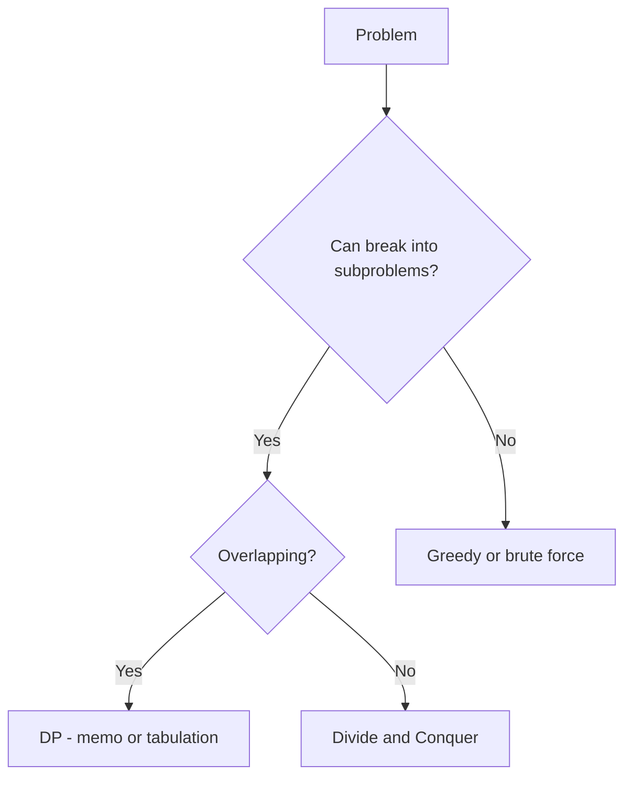
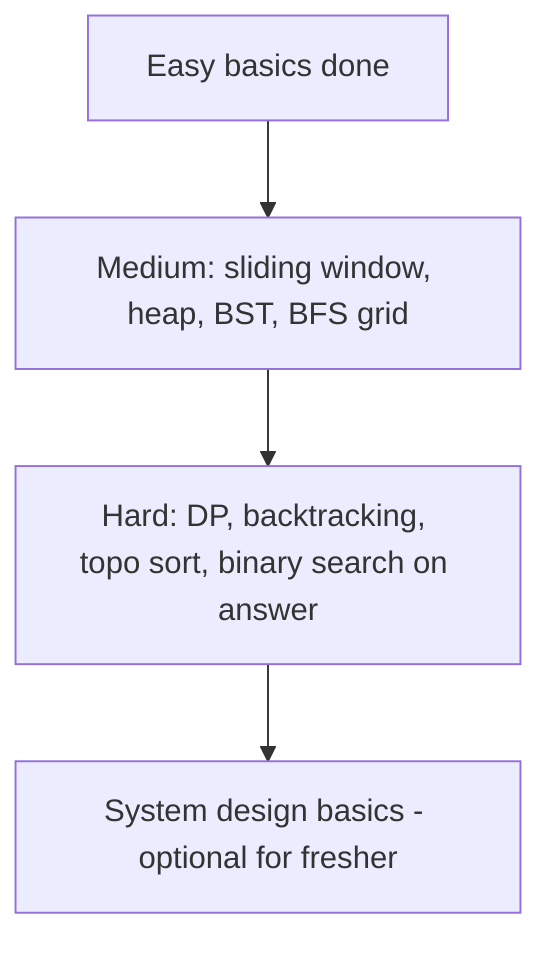

# Advanced DSA — Medium & Hard Topics

For students who have covered basics and want to tackle **medium–hard** interview questions (product companies, security/networking firms, tier-1 campus drives).

---

## Part 1: Binary Search (Beyond Basic)

### Standard Template

```
ALGORITHM BinarySearch(arr, target)
PRECONDITION: arr is sorted ascending

BEGIN
    lo ← 0
    hi ← LENGTH(arr) − 1

    WHILE lo ≤ hi DO
        mid ← lo + (hi − lo) / 2
        IF arr[mid] = target THEN RETURN mid
        ELSE IF arr[mid] < target THEN lo ← mid + 1
        ELSE hi ← mid − 1
        END IF
    END WHILE

    RETURN −1
END
```

**Time:** O(log n)

### Search Insert Position / Lower Bound

```
// First index where arr[i] >= target
WHILE lo < hi DO
    mid ← lo + (hi − lo) / 2
    IF arr[mid] < target THEN lo ← mid + 1
    ELSE hi ← mid
END WHILE
RETURN lo
```

**Problems:** Search Insert Position, First Bad Version, Sqrt(x)

### Binary Search on Answer (Hard pattern)

When answer lies in a range and you can check "is X feasible?"

**Example:** Koko Eating Bananas, Capacity to Ship Packages  
Pattern: `lo = min possible, hi = max possible → mid → if feasible, hi = mid else lo = mid + 1`

---

## Part 2: Sliding Window (Advanced)

### Variable Window — Minimum Window Substring

```
ALGORITHM MinWindow(s, t)
INPUT : source string s, target string t
OUTPUT: smallest substring of s containing all chars of t

BEGIN
    need ← frequency map of t
    missing ← LENGTH(t)
    left ← 0
    best ← (0, ∞)

    FOR right ← 0 TO LENGTH(s) − 1 DO
        IF s[right] in need THEN
            IF need[s[right]] > 0 THEN missing ← missing − 1 END IF
            need[s[right]] ← need[s[right]] − 1
        END IF

        WHILE missing = 0 DO
            IF right − left + 1 < best.length THEN best ← (left, right) END IF
            IF s[left] in need THEN
                need[s[left]] ← need[s[left]] + 1
                IF need[s[left]] > 0 THEN missing ← missing + 1 END IF
            END IF
            left ← left + 1
        END WHILE
    END FOR

    RETURN substring from best or ""
END
```

**Time:** O(n) &nbsp; **Problems:** Minimum Window Substring, Permutation in String

### Fixed Window — Max Sum Subarray of Size K

```
windowSum ← sum of first k elements
maxSum ← windowSum
FOR i ← k TO n − 1 DO
    windowSum ← windowSum + arr[i] − arr[i − k]
    maxSum ← MAX(maxSum, windowSum)
END FOR
```

---

## Part 3: Dynamic Programming (Intro)

### When to Use DP

- Optimal substructure + overlapping subproblems
- Count ways, min/max cost, yes/no feasibility



### 1. Climbing Stairs (1D DP)

```
dp[0] ← 1, dp[1] ← 1
FOR i ← 2 TO n DO
    dp[i] ← dp[i−1] + dp[i−2]
END FOR
RETURN dp[n]
```

Same as Fibonacci. **Space optimized:** only keep last two values.

### 2. Coin Change (Unbounded Knapsack)

```
dp[0..amount] ← ∞, dp[0] ← 0
FOR coin IN coins DO
    FOR x ← coin TO amount DO
        dp[x] ← MIN(dp[x], dp[x − coin] + 1)
    END FOR
END FOR
RETURN dp[amount] IF finite ELSE −1
```

**Time:** O(amount × numCoins)

### 3. Longest Increasing Subsequence — O(n log n)

Maintain `tails[]` — smallest tail of all increasing subsequences of length i+1.

```
FOR EACH x IN nums DO
    pos ← lower_bound(tails, x)
    IF pos = LENGTH(tails) THEN APPEND(tails, x)
    ELSE tails[pos] ← x
    END IF
END FOR
RETURN LENGTH(tails)
```

### 4. 0/1 Knapsack

```
FOR i ← 1 TO n DO
    FOR w ← capacity DOWNTO weight[i] DO    // reverse to avoid reuse
        dp[w] ← MAX(dp[w], dp[w − weight[i]] + value[i])
    END FOR
END FOR
```

---

## Part 4: Backtracking

### Subsets

```
ALGORITHM Subsets(nums)
BEGIN
    result ← empty list
    current ← empty list

    FUNCTION Backtrack(start):
        APPEND(result, copy of current)
        FOR i ← start TO LENGTH(nums) − 1 DO
            APPEND(current, nums[i])
            Backtrack(i + 1)
            REMOVE last from current
        END FOR
    END FUNCTION

    Backtrack(0)
    RETURN result
END
```

**Time:** O(n × 2^n)

### Permutations

```
Backtrack when current.length = n → add to result
FOR each unused element: pick → recurse → unpick
```

**Problems:** Subsets, Permutations, Combination Sum, N-Queens (hard), Word Search

---

## Part 5: Heap / Priority Queue

| Problem | Heap type | Pattern |
|---------|-----------|---------|
| Kth Largest Element | Min-heap size K | Keep K largest |
| Top K Frequent Elements | Min-heap or bucket sort | Count then top K |
| Merge K Sorted Lists | Min-heap of heads | Pop smallest, push next |
| Find Median from Stream | Two heaps (max + min) | Balance sizes |

### Kth Largest Element

```
minHeap ← empty
FOR EACH x IN nums DO
    INSERT(minHeap, x)
    IF SIZE(minHeap) > k THEN EXTRACT-MIN(minHeap) END IF
END FOR
RETURN minHeap.top
```

**Time:** O(n log k)

---

## Part 6: Trie (Prefix Tree)

```
TrieNode:
    children[26]   // or map char → node
    isEndOfWord

INSERT(word): walk char by char, mark end
SEARCH(word): walk + check isEndOfWord
STARTSWITH(prefix): walk + return true if path exists
```

**Problems:** Implement Trie, Word Search II, Longest Word in Dictionary

---

## Part 7: Union-Find (Disjoint Set)

```
parent[i] ← i
rank[i] ← 0

FIND(x):
    IF parent[x] ≠ x THEN parent[x] ← FIND(parent[x])   // path compression
    RETURN parent[x]

UNION(x, y):
    px ← FIND(x), py ← FIND(y)
    IF px = py THEN RETURN
    Attach smaller rank tree under root (union by rank)
```

**Use for:** Number of Connected Components, Redundant Connection, Accounts Merge  
**Time:** nearly O(1) amortized per operation

---

## Part 8: Graph (Medium–Hard)

### Topological Sort (Kahn's BFS)

```
inDegree ← count incoming edges for each node
queue ← all nodes with inDegree 0
order ← empty

WHILE queue NOT EMPTY DO
    u ← DEQUEUE
    APPEND(order, u)
    FOR v IN adj[u] DO
        inDegree[v] ← inDegree[v] − 1
        IF inDegree[v] = 0 THEN ENQUEUE(v)
    END IF
END WHILE

IF LENGTH(order) < n THEN cycle exists (no valid topo sort)
```

**Problems:** Course Schedule I & II, Alien Dictionary

### Dijkstra — see [dsa-trees-graphs.md](dsa-trees-graphs.md)

### Bipartite Check (BFS coloring)

Color nodes 0/1; if neighbor has same color → not bipartite.

---

## Part 9: Bit Manipulation

| Trick | Expression |
|-------|------------|
| Check bit i set | `(n >> i) & 1` |
| Set bit i | `n \| (1 << i)` |
| Clear bit i | `n & ~(1 << i)` |
| Toggle bit i | `n ^ (1 << i)` |
| Power of 2 | `n > 0 AND (n & (n−1)) = 0` |
| XOR all → find single unique | `result ^= num` for each |

**Problems:** Single Number, Counting Bits, Subsets via bitmask

---

## Part 10: Two Pointers (Hard)

| Problem | Technique |
|---------|-----------|
| 3Sum | Sort + fix i + two pointers on rest |
| Trapping Rain Water | Two pointers or prefix max arrays |
| Container With Most Water | Wide pointers, move shorter side |

### Trapping Rain Water

```
left ← 0, right ← n − 1
leftMax ← rightMax ← 0, water ← 0

WHILE left < right DO
    IF height[left] < height[right] THEN
        IF height[left] ≥ leftMax THEN leftMax ← height[left]
        ELSE water ← water + (leftMax − height[left])
        left ← left + 1
    ELSE
        // symmetric for right
    END IF
END WHILE
```

---

## Difficulty Map — What to Study When



| Tier | Topics | Example companies style |
|------|--------|---------------------------|
| Medium | Heap, window, 3Sum, topo sort, LIS | Security/product campus round 2 |
| Hard | DP knapsack, min window, union-find, N-queens | Strong candidate differentiation |
| Bonus | Trie, bit tricks, Dijkstra | Tier-1 / competitive shortlists |

[← Back to index](../README.md) · [← DBMS advanced queries](dbms-sql.md)
