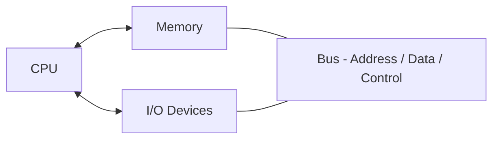
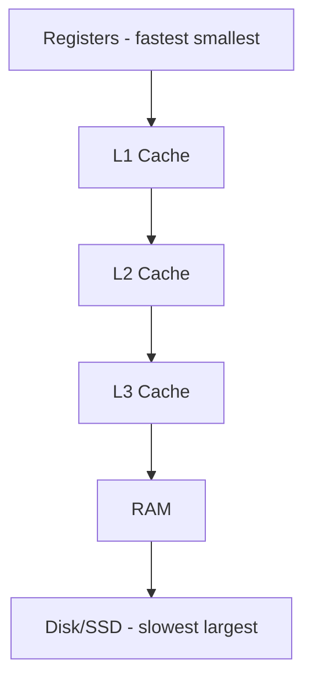

# Computer Organization & Architecture (COA) — Basics

Primarily for **OA MCQs** — rarely deep F2F for software roles. Skim before online assessments.

---

## Part 1: Von Neumann Architecture



**Stored program concept:** Instructions and data live in same memory.

| Component | Role |
|-----------|------|
| **CPU** | Fetch, decode, execute instructions |
| **ALU** | Arithmetic and logic operations |
| **Control Unit** | Directs data flow and operations |
| **Registers** | Fast storage inside CPU |
| **Memory** | RAM — instructions + data |
| **I/O** | Keyboard, disk, network |

---

## Part 2: Memory Hierarchy



| Level | Size (typical) | Access time |
|-------|----------------|-------------|
| Registers | Bytes | ~1 cycle |
| L1 cache | 32–64 KB | ~1–4 cycles |
| L2 cache | 256 KB – 1 MB | ~10 cycles |
| L3 cache | 8–64 MB | ~20–40 cycles |
| RAM | GBs | ~100 ns |
| SSD | TBs | ~100 μs |

**Principle:** Faster memory = smaller and more expensive.

---

## Part 3: Cache Concepts

| Term | Meaning |
|------|---------|
| **Cache hit** | Data found in cache — fast |
| **Cache miss** | Not in cache — fetch from lower level |
| **Temporal locality** | Same data accessed again soon → keep in cache |
| **Spatial locality** | Nearby addresses accessed → load block |
| **Cache line / block** | Unit transferred between memory and cache |

### Mapping (Know Names)

| Type | Idea |
|------|------|
| **Direct mapped** | Each memory block → one cache location |
| **Fully associative** | Block can go anywhere in cache |
| **Set associative** | Block maps to one of N places in a set |

**Interview one-liner:** Cache exploits locality to bridge CPU–RAM speed gap.

---

## Part 4: Pipelining

Execute multiple instructions in overlapping stages:

```
Instruction:  Fetch → Decode → Execute → Memory → Writeback

Cycle 1:  Instr1 Fetch
Cycle 2:  Instr1 Decode | Instr2 Fetch
Cycle 3:  Instr1 Execute | Instr2 Decode | Instr3 Fetch
...
```

**Throughput** increases (more instructions per cycle).

**Hazards:**
| Hazard | Cause | Fix |
|--------|-------|-----|
| **Structural** | Hardware conflict | Duplicate hardware |
| **Data** | Instruction depends on previous result | Forwarding, stall |
| **Control** | Branch changes flow | Branch prediction, flush pipeline |

---

## Part 5: Addressing Modes (Names Only)

| Mode | Example idea |
|------|--------------|
| Immediate | Operand is constant in instruction |
| Direct | Address of operand in instruction |
| Register | Operand in register |
| Indirect | Register holds address of operand |
| Indexed | Base + offset (arrays) |

---

## Part 6: Common OA MCQs

| Question | Answer |
|----------|--------|
| Fastest memory? | Registers |
| Purpose of cache? | Reduce average memory access time |
| L1 vs L3? | L1 smaller, faster, per-core; L3 shared, larger |
| What is pipeline stall? | Pause when hazard can't be resolved immediately |
| Harvard vs Von Neumann? | Harvard — separate instruction and data memory |
| Big-endian vs little-endian? | Byte order in multi-byte values |
| What is TLB? | Cache for page table entries (see [operating-systems.md](operating-systems.md)) |

---

## Part 7: Digital Logic (Minimal)

| Gate | Output 1 when |
|------|---------------|
| AND | Both inputs 1 |
| OR | Any input 1 |
| NOT | Invert input |
| XOR | Inputs differ |
| NAND | NOT (A AND B) |

**Flip-flop:** 1-bit storage — basis of registers and memory.

**K-map:** Karnaugh map — simplify Boolean expressions visually (OA only).

---

## Skip Unless OA Heavy

- Detailed gate-level circuit design
- Booth's multiplication algorithm
- IEEE 754 floating point bit layout (know it exists)

[← Back to index](../README.md) · [OA Prep →](oa-preparation.md)
