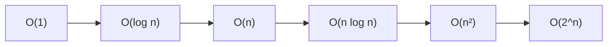

# Complexity Analysis — Quick Revision

## Big-O Cheat Sheet

| Notation | Name | Example |
|----------|------|---------|
| O(1) | Constant | Hash map get, array index |
| O(log n) | Logarithmic | Binary search |
| O(n) | Linear | Single loop, linear scan |
| O(n log n) | Linearithmic | Merge sort, heap sort |
| O(n²) | Quadratic | Nested loops, bubble sort |
| O(2^n) | Exponential | Subsets, brute-force combinatorics |
| O(n!) | Factorial | Permutations brute force |



**Rule:** Drop constants and lower-order terms. O(3n + 5) → O(n).

---

## Common Operations

| Structure | Access | Search | Insert | Delete |
|-----------|--------|--------|--------|--------|
| Array | O(1) | O(n) | O(n) | O(n) |
| Linked List | O(n) | O(n) | O(1)* | O(1)* |
| Hash Map | — | O(1) avg | O(1) avg | O(1) avg |
| BST (balanced) | — | O(log n) | O(log n) | O(log n) |
| Heap | — | O(n) | O(log n) | O(log n) |

*At known position (e.g. head).

---

## How to Analyze Code

### Single loop → O(n)

```
FOR i ← 0 TO n − 1 DO
    ... constant work ...
END FOR
→ O(n)
```

### Nested loops → O(n²)

```
FOR i ← 0 TO n − 1 DO
    FOR j ← 0 TO n − 1 DO
        ...
    END FOR
END FOR
→ O(n²)
```

### Halving each step → O(log n)

```
WHILE n > 0 DO
    n ← n / 2
END WHILE
→ O(log n)
```

### Loop × binary search → O(n log n)

```
FOR each element DO
    BinarySearch(...)
END FOR
→ O(n log n)
```

### Recursion — Master Template

```
ALGORITHM AnalyzeRecursion
BEGIN
    // Count: how many calls? how much work per call?
    // Tree depth = h, branching factor = b
    // Often: O(b^h) time, O(h) space (call stack)
END
```

| Pattern | Time | Space |
|---------|------|-------|
| Tree DFS (visit all nodes) | O(n) | O(h) stack |
| Merge sort | O(n log n) | O(n) |
| Binary search recursion | O(log n) | O(log n) stack |

---

## Space Complexity

| What counts | Example |
|-------------|---------|
| Extra arrays/maps | O(n) space for hash map |
| Recursion stack | O(h) for tree depth h |
| Output array | Often excluded if required by problem |
| In-place algorithms | O(1) extra space |

**Interview phrase:** "Time O(n) for one pass, space O(n) for the hash map."

---

## Trade-off Talking Points

| Situation | Say this |
|-----------|----------|
| Brute force → optimal | "Start O(n²), optimize to O(n) using hash map" |
| Sort first | "O(n log n) sort, then O(n) scan → overall O(n log n)" |
| BFS vs DFS | "Both O(V+E); BFS uses O(V) queue, DFS O(V) stack" |
| DP vs greedy | "DP guarantees optimal; greedy is faster if applicable" |

---

## Amortized Complexity (Bonus)

| Structure | Operation | Amortized |
|-----------|-----------|-----------|
| Dynamic array (vector) | push_back | O(1) amortized |
| Hash map | insert | O(1) amortized (rehash occasionally) |

**One-liner:** Occasional expensive operation spread over many cheap ones → average still O(1).

---

## Interview Checklist

Before saying "done":
- [ ] Stated **time** complexity
- [ ] Stated **space** complexity (including recursion stack)
- [ ] Mentioned **best vs worst** if they differ (e.g. quicksort O(n log n) avg, O(n²) worst)

[← Back to index](../README.md)
