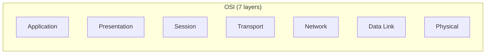
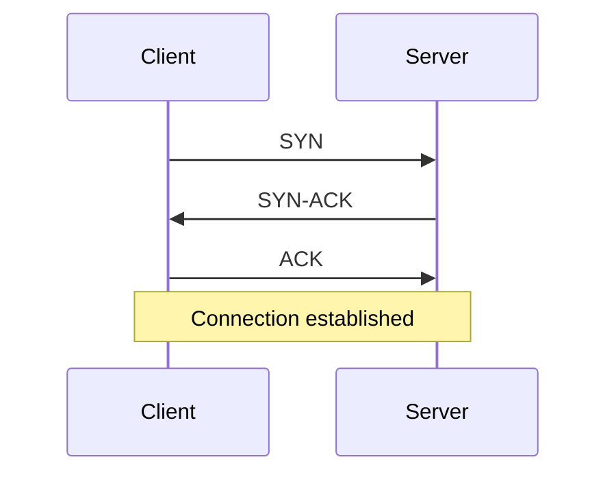
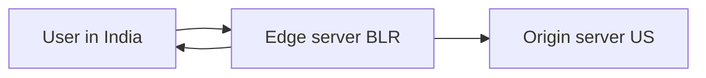

# Computer Networks — Quick Revision

## OSI vs TCP/IP



| TCP/IP Layer | OSI Layers | Protocols |
|--------------|------------|-----------|
| Application | 5–7 | HTTP, DNS, FTP, SMTP |
| Transport | 4 | TCP, UDP |
| Internet | 3 | IP, ICMP |
| Network Access | 1–2 | Ethernet, Wi-Fi |

**Interview shortcut:** Know **Application, Transport, Network, Link** — that's enough.

## TCP vs UDP

| | TCP | UDP |
|-|-----|-----|
| Connection | Connection-oriented | Connectionless |
| Reliability | Guaranteed delivery, retransmit | Best effort |
| Ordering | In order | Not guaranteed |
| Speed | Slower (overhead) | Faster |
| Use | HTTP, email, file transfer | DNS, video streaming, VoIP |

## TCP 3-Way Handshake



1. **SYN** — client wants to connect
2. **SYN-ACK** — server agrees
3. **ACK** — client confirms

**Teardown:** FIN → ACK → FIN → ACK (4-way)

## IP Addressing

| Type | Range / Notes |
|------|---------------|
| IPv4 | 32-bit, e.g. 192.168.1.1 |
| Private | 10.x, 172.16–31.x, 192.168.x |
| Loopback | 127.0.0.1 |
| IPv6 | 128-bit, bigger address space |

**NAT:** Maps private IP → public IP for internet access.

## DNS Resolution

```
Browser → OS cache → Recursive resolver → Root → TLD → Authoritative → IP
```

| Record | Purpose |
|--------|---------|
| A | Domain → IPv4 |
| AAAA | Domain → IPv6 |
| CNAME | Alias |
| MX | Mail server |

## HTTP Basics

| Code | Meaning |
|------|---------|
| 200 | OK |
| 301/302 | Redirect |
| 400 | Bad request |
| 401 | Unauthorized |
| 403 | Forbidden |
| 404 | Not found |
| 500 | Server error |

**HTTP vs HTTPS:** HTTPS = HTTP + TLS encryption.

## TLS Handshake (High Level)

1. Client hello (supported ciphers)
2. Server hello + certificate
3. Client verifies cert, generates session key
4. Encrypted communication begins

## DHCP

Automatically assigns IP, subnet mask, gateway, DNS to a host.

## ARP

Maps IP address → MAC address on local network.

## Common Devices

| Device | Layer | Function |
|--------|-------|----------|
| Hub | 1 | Broadcasts to all (legacy) |
| Switch | 2 | Forwards by MAC |
| Router | 3 | Routes between networks by IP |
| Gateway | 3/7 | Exit point to other networks |

## Proxy vs VPN

| | Proxy | VPN |
|-|-------|-----|
| Scope | App-level often | Entire device traffic |
| Encryption | Optional | Yes |
| Use | Filter/cache web traffic | Secure remote access |

## Common Interview Questions

1. TCP vs UDP — when to use each?
2. Explain 3-way handshake
3. What happens when you type a URL in browser?
4. Difference between hub, switch, router?
5. HTTP vs HTTPS?
6. What is DNS?

### "Type URL in browser" — Answer Flow

```
DNS lookup → TCP connect → TLS (if HTTPS) → HTTP request
→ Server response → Browser renders
```

---

## Part 2: Medium & Advanced Topics

### HTTP Methods

| Method | Purpose | Idempotent? |
|--------|---------|-------------|
| GET | Read resource | Yes |
| POST | Create / submit | No |
| PUT | Replace resource | Yes |
| PATCH | Partial update | No |
| DELETE | Remove | Yes |
| HEAD | GET without body | Yes |

**Idempotent:** Same request repeated = same effect (POST is not).

### REST Principles (Quick)

- **Stateless** — server stores no client session between requests
- **Resources** identified by URLs (`/users/42`)
- **HTTP verbs** map to CRUD
- **JSON** typical response format

### TCP Flow Control vs Congestion Control

| | Flow Control | Congestion Control |
|-|--------------|-------------------|
| **Purpose** | Sender doesn't overwhelm **receiver** | Sender doesn't overwhelm **network** |
| **Mechanism** | Sliding window, receiver advertises window | Slow start, congestion window (cwnd), AIMD |
| **Key idea** | Receiver buffer size | Packet loss → reduce send rate |

### Subnetting (Basics)

```
IP: 192.168.1.10/24
     └── 24-bit network prefix, 8-bit host part
Subnet mask: 255.255.255.0
Hosts in subnet: 2^8 − 2 = 254 (minus network + broadcast)
```

**Interview:** Given CIDR, know how many hosts and whether two IPs are in same subnet.

### CDN (Content Delivery Network)



- Cache static content (images, JS, video) at edge locations
- Lower latency, reduce origin load
- DNS routes user to nearest edge

### Load Balancer

Distributes traffic across multiple servers.

| Layer | Routes by |
|-------|-----------|
| L4 (Transport) | IP + port |
| L7 (Application) | URL path, headers, cookies |

Algorithms: Round Robin, Least Connections, IP Hash.

### WebSocket vs HTTP

| HTTP | WebSocket |
|------|-----------|
| Request–response | Full-duplex persistent connection |
| Short-lived per request | Real-time chat, live updates |

### ICMP

Used for diagnostics — **ping** (echo request/reply), **traceroute** (TTL expiry).

### Advanced Interview Questions

1. **SYN flood attack?** — Half-open connections exhaust server; mitigated by SYN cookies, rate limiting.
2. **Difference HTTP 401 vs 403?** — 401 = not authenticated; 403 = authenticated but forbidden.
3. **Why is UDP used for DNS?** — Low overhead, single query/response, speed.
4. **What is MTU?** — Max Transmission Unit (~1500 bytes Ethernet); fragmentation if exceeded.
5. **How does a proxy differ from a reverse proxy?** — Forward proxy: client-side (hide client); reverse proxy: server-side (hide backend, load balance).
6. **TLS 1.3 improvement?** — Fewer round trips in handshake (faster).

[← Back to index](../README.md) · [Advanced DSA →](advanced-dsa.md)

