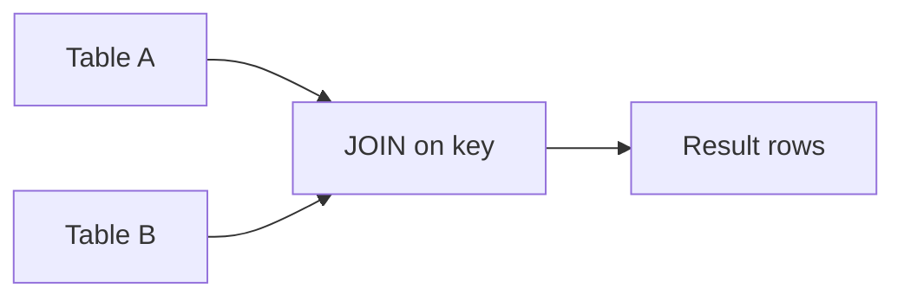
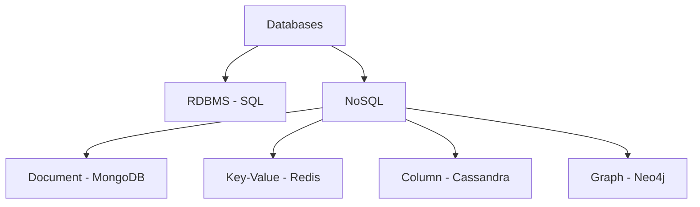

# DBMS & SQL — Quick Revision

## Part 1: Foundations

### ACID Properties

| Property | Meaning |
|----------|---------|
| **A**tomicity | All or nothing — transaction succeeds fully or rolls back |
| **C**onsistency | DB moves from one valid state to another |
| **I**solation | Concurrent transactions don't interfere |
| **D**urability | Committed data survives crashes |

### Normalization

| Form | Rule |
|------|------|
| 1NF | Atomic values, no repeating groups |
| 2NF | 1NF + no partial dependency on composite key |
| 3NF | 2NF + no transitive dependency (non-key → non-key) |
| BCNF | Every determinant is a candidate key (stricter 3NF) |

**Interview answer:** Normalization reduces redundancy; denormalization improves read speed.

### Keys

| Key | Purpose |
|-----|---------|
| Primary | Unique row identifier |
| Foreign | References another table's PK |
| Unique | No duplicates (NULL rules vary) |
| Composite | Multiple columns form the key |
| Candidate | Any minimal set that can be PK |
| Super key | Any set that uniquely identifies a row |

---

## Part 2: SQL Query Structure

### Clause Execution Order (memorize this)


**Write order:** `SELECT → FROM → JOIN → WHERE → GROUP BY → HAVING → ORDER BY → LIMIT`

| Clause | Filters / acts on |
|--------|-------------------|
| **WHERE** | Individual rows **before** grouping |
| **HAVING** | Groups **after** `GROUP BY` |
| **GROUP BY** | Collapses rows with same column values |
| **ORDER BY** | Sorts final result |
| **LIMIT n** | Returns first n rows |
| **OFFSET k** | Skips first k rows (pagination) |

### WHERE vs HAVING — Classic Trap

```sql
-- WRONG: aggregate in WHERE
SELECT dept_id, COUNT(*) FROM employees
WHERE COUNT(*) > 5 GROUP BY dept_id;

-- CORRECT: filter groups with HAVING
SELECT dept_id, COUNT(*) AS cnt
FROM employees
GROUP BY dept_id
HAVING COUNT(*) > 5;
```

---

## Part 3: Essential SQL Queries (Easy → Medium)

### 1. Second / Nth Highest Salary

```sql
-- 2nd highest
SELECT MAX(salary) FROM employees
WHERE salary < (SELECT MAX(salary) FROM employees);

-- Nth highest (MySQL / PostgreSQL)
SELECT DISTINCT salary FROM employees
ORDER BY salary DESC
LIMIT 1 OFFSET 2;          -- 3rd highest (OFFSET = N-1)

-- Nth highest (portable — subquery count)
SELECT salary FROM employees e
WHERE (SELECT COUNT(DISTINCT salary) FROM employees
       WHERE salary > e.salary) = 2;   -- 3rd highest
```

### 2. Employees Earning More Than Their Manager

```sql
SELECT e.name AS employee, m.name AS manager
FROM employees e
JOIN employees m ON e.manager_id = m.id
WHERE e.salary > m.salary;
```

### 3. Department With Highest Average Salary

```sql
SELECT dept_id, AVG(salary) AS avg_sal
FROM employees
GROUP BY dept_id
ORDER BY avg_sal DESC
LIMIT 1;
```

### 4. Departments With No Employees

```sql
SELECT d.dept_id, d.dept_name
FROM departments d
LEFT JOIN employees e ON d.dept_id = e.dept_id
WHERE e.id IS NULL;
```

### 5. Duplicate Emails (find, not delete)

```sql
SELECT email, COUNT(*) AS cnt
FROM users
GROUP BY email
HAVING COUNT(*) > 1;
```

### 6. Delete Duplicates (keep lowest id)

```sql
DELETE FROM users
WHERE id NOT IN (
    SELECT MIN(id) FROM users GROUP BY email
);
-- PostgreSQL: use DELETE ... USING or CTE (see advanced section)
```

### 7. Running Total / Cumulative Sum

```sql
SELECT order_date, amount,
       SUM(amount) OVER (ORDER BY order_date) AS running_total
FROM orders;
```

### 8. Rank Salaries Within Department (Window Function)

```sql
SELECT name, dept_id, salary,
       RANK()       OVER (PARTITION BY dept_id ORDER BY salary DESC) AS rnk,
       DENSE_RANK() OVER (PARTITION BY dept_id ORDER BY salary DESC) AS dense_rnk,
       ROW_NUMBER() OVER (PARTITION BY dept_id ORDER BY salary DESC) AS row_num
FROM employees;
```

| Function | Ties behavior |
|----------|---------------|
| `ROW_NUMBER()` | Unique rank (1,2,3) — breaks ties arbitrarily |
| `RANK()` | Same rank, skip next (1,1,3) |
| `DENSE_RANK()` | Same rank, no skip (1,1,2) |

### 9. Top 3 Salaries Per Department

```sql
WITH ranked AS (
    SELECT name, dept_id, salary,
           DENSE_RANK() OVER (PARTITION BY dept_id ORDER BY salary DESC) AS rnk
    FROM employees
)
SELECT name, dept_id, salary FROM ranked WHERE rnk <= 3;
```

### 10. Customers Who Never Ordered

```sql
SELECT c.id, c.name
FROM customers c
LEFT JOIN orders o ON c.id = o.customer_id
WHERE o.id IS NULL;

-- Alternative with NOT EXISTS (often faster on large data)
SELECT c.id, c.name FROM customers c
WHERE NOT EXISTS (SELECT 1 FROM orders o WHERE o.customer_id = c.id);
```

### 11. Consecutive Login Days (Medium — self-join / window)

```sql
-- Find users who logged in 3+ consecutive days
WITH daily AS (
    SELECT user_id, login_date,
           login_date - ROW_NUMBER() OVER (
               PARTITION BY user_id ORDER BY login_date
           )::int AS grp
    FROM logins
)
SELECT DISTINCT user_id FROM daily
GROUP BY user_id, grp
HAVING COUNT(*) >= 3;
```

### 12. Pivot-Style Report (CASE + GROUP BY)

```sql
SELECT dept_id,
       SUM(CASE WHEN gender = 'M' THEN 1 ELSE 0 END) AS male_count,
       SUM(CASE WHEN gender = 'F' THEN 1 ELSE 0 END) AS female_count
FROM employees
GROUP BY dept_id;
```

### 13. UNION vs UNION ALL

```sql
SELECT name FROM table_a
UNION                          -- removes duplicates (slower)
SELECT name FROM table_b;

SELECT name FROM table_a
UNION ALL                      -- keeps duplicates (faster)
SELECT name FROM table_b;
```

---

## Part 4: Joins (Visual + Advanced)



| Join | Returns |
|------|---------|
| INNER | Matching rows only |
| LEFT | All from left + matches from right (NULL if no match) |
| RIGHT | All from right + matches from left |
| FULL | All from both |
| CROSS | Every row paired with every row (Cartesian) |
| SELF | Table joined to itself (manager–employee) |

### Three-Table Join

```sql
SELECT e.name, d.dept_name, p.project_name
FROM employees e
INNER JOIN departments d ON e.dept_id = d.dept_id
INNER JOIN project_assignments pa ON e.id = pa.emp_id
INNER JOIN projects p ON pa.project_id = p.id
WHERE d.dept_name = 'Engineering';
```

---

## Part 5: Subqueries

| Type | Example use |
|------|-------------|
| Scalar | `WHERE salary > (SELECT AVG(salary) FROM employees)` |
| IN / NOT IN | `WHERE dept_id IN (SELECT id FROM depts WHERE location = 'BLR')` |
| EXISTS / NOT EXISTS | Check row existence — often better than IN |
| Correlated | Inner query references outer row (nth highest, running filters) |

```sql
-- Correlated: employees above dept average
SELECT e.name, e.salary, e.dept_id
FROM employees e
WHERE e.salary > (
    SELECT AVG(salary) FROM employees WHERE dept_id = e.dept_id
);
```

---

## Part 6: Transactions

### Basic Commands

```sql
BEGIN;                    -- or START TRANSACTION
UPDATE accounts SET balance = balance - 100 WHERE id = 1;
UPDATE accounts SET balance = balance + 100 WHERE id = 2;
COMMIT;                   -- save permanently

BEGIN;
DELETE FROM orders WHERE id = 99;
ROLLBACK;                 -- undo everything since BEGIN

SAVEPOINT sp1;
UPDATE ... ;
ROLLBACK TO sp1;          -- undo only after savepoint
COMMIT;
```

### Concurrency Anomalies

| Anomaly | What happens | Example |
|---------|--------------|---------|
| **Dirty read** | Read uncommitted data from another txn | See rollback'd changes |
| **Non-repeatable read** | Same query, different result (row updated) | Balance changes mid-txn |
| **Phantom read** | Same query, new rows appear | New rows inserted in range |
| **Lost update** | Two txns overwrite each other | Both read 100, both write 90 |

### Isolation Levels

| Level | Dirty read | Non-repeatable | Phantom |
|-------|------------|----------------|---------|
| Read Uncommitted | Yes | Yes | Yes |
| Read Committed | No | Yes | Yes |
| Repeatable Read | No | No | Yes |
| Serializable | No | No | No |

**Default:** MySQL InnoDB = Repeatable Read; PostgreSQL = Read Committed.

### Interview Scenario

> Two users transfer money from the same account simultaneously. How do you prevent lost updates?

**Answer:** Wrap in a transaction with appropriate isolation; use `SELECT ... FOR UPDATE` (row lock) before updating balance.

---

## Part 7: Indexing & Query Optimization

| Index type | Best for |
|------------|----------|
| **B-Tree** | Equality + range (`>`, `<`, `BETWEEN`) — default |
| **Hash** | Exact match only (`=`) |
| **Composite** | Multi-column queries — leftmost prefix rule applies |

**Composite index `(dept_id, salary)`** helps:
- `WHERE dept_id = 5`
- `WHERE dept_id = 5 AND salary > 50000`
- Does **not** help: `WHERE salary > 50000` alone (no left prefix)

**Trade-off:** Faster SELECT, slower INSERT/UPDATE/DELETE (index maintenance).

### EXPLAIN (concept)

`EXPLAIN SELECT ...` shows whether DB uses index scan vs full table scan — key for optimization discussions.

---

## Part 8: Database Types



| Type | Model | Examples | Best for |
|------|-------|----------|----------|
| **RDBMS** | Tables, rows, SQL, ACID | MySQL, PostgreSQL, Oracle | Transactions, complex joins |
| **Document** | JSON-like documents | MongoDB | Flexible schema, nested data |
| **Key-Value** | Key → value | Redis, DynamoDB | Cache, sessions, counters |
| **Column** | Wide columns, distributed | Cassandra, HBase | Write-heavy, time-series at scale |
| **Graph** | Nodes + edges | Neo4j | Social networks, relationships |

### SQL vs NoSQL — When to Use

| Choose SQL | Choose NoSQL |
|------------|--------------|
| ACID transactions required | Massive horizontal scale |
| Complex joins & reporting | Flexible / evolving schema |
| Structured relational data | High write throughput, simple access patterns |

### CAP Theorem (Advanced — one-liner)

In a distributed system, pick **2 of 3:** **C**onsistency, **A**vailability, **P**artition tolerance.  
Most distributed DBs choose **AP** (eventual consistency) or **CP** (strong consistency during partition).

---

## Part 9: Advanced SQL Patterns

### CTE (Common Table Expression)

```sql
WITH dept_avg AS (
    SELECT dept_id, AVG(salary) AS avg_sal FROM employees GROUP BY dept_id
)
SELECT e.name, e.salary, d.avg_sal
FROM employees e
JOIN dept_avg d ON e.dept_id = d.dept_id
WHERE e.salary > d.avg_sal;
```

### DELETE with CTE (PostgreSQL-safe duplicate removal)

```sql
WITH keep AS (
    SELECT MIN(id) AS id FROM users GROUP BY email
)
DELETE FROM users WHERE id NOT IN (SELECT id FROM keep);
```

### Pagination (Production Pattern)

```sql
SELECT id, name FROM products
ORDER BY id
LIMIT 20 OFFSET 40;    -- page 3, 20 per page (OFFSET = (page-1) * pageSize)
```

> **Advanced note:** Large OFFSET is slow; use **keyset pagination** (`WHERE id > last_seen_id LIMIT 20`) instead.

---

## Part 10: Interview Rapid Fire

| Question | Short answer |
|----------|--------------|
| Primary vs Foreign key? | PK uniquely identifies row; FK references PK in another table |
| INNER vs LEFT join? | INNER = matches only; LEFT = all left rows + NULL if no match |
| WHERE vs HAVING? | WHERE filters rows; HAVING filters groups |
| Clustered vs Non-clustered index? | Clustered = data sorted by index (one per table); non-clustered = separate pointer structure |
| What is a view? | Virtual table from a saved query — no data duplication |
| What is a trigger? | Code that runs automatically on INSERT/UPDATE/DELETE |
| Normalization vs denormalization? | Reduce redundancy vs optimize read performance |
| Deadlock in DB? | Two txns waiting for each other's locks → DB kills one |

---

## Practice Progression

| Level | Focus |
|-------|-------|
| **Easy** | SELECT, WHERE, ORDER BY, basic JOIN, COUNT/AVG |
| **Medium** | GROUP BY + HAVING, self-join, subqueries, LEFT JOIN nulls |
| **Hard** | Window functions, consecutive days, CTE, correlated subqueries, txn scenarios |

[← Back to index](../README.md) · [Advanced DSA →](advanced-dsa.md)
