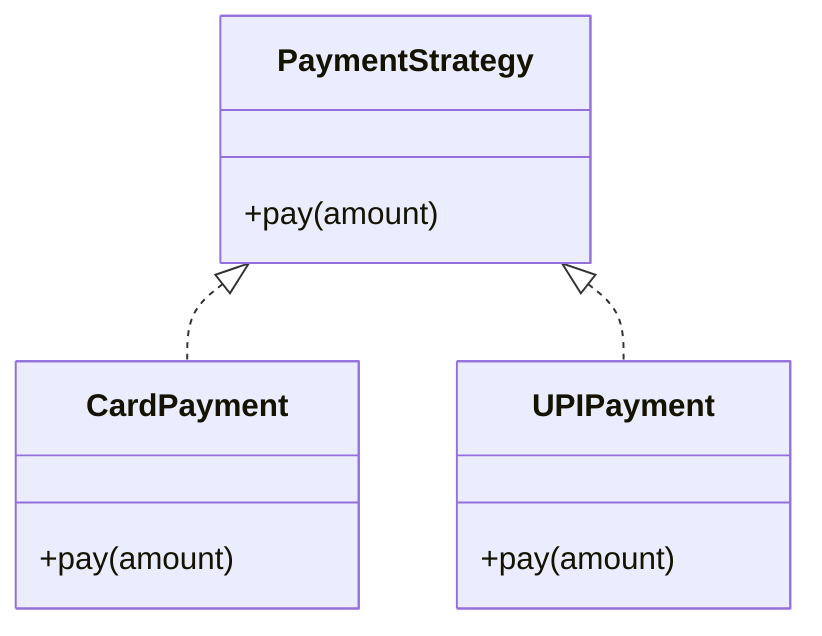
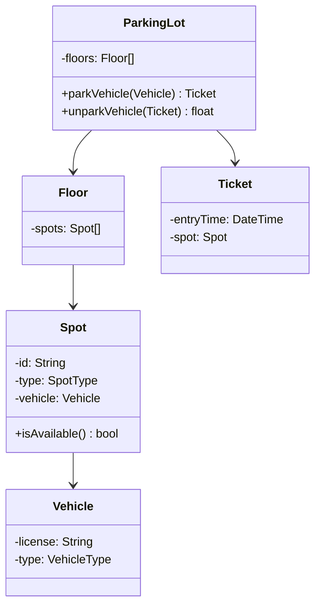
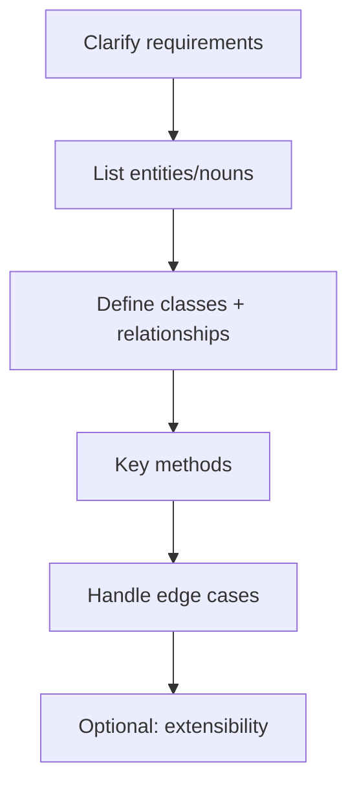

# Design Patterns & Low-Level Design (LLD)

For "design a class system" questions — Parking Lot, Library, Logger, Rate Limiter. Fresher-level, not full system design.

---

## Part 1: Common Design Patterns

| Pattern | Purpose | One-liner |
|---------|---------|-----------|
| **Singleton** | One instance only | DB connection pool |
| **Factory** | Create objects without specifying class | `ShapeFactory.create("circle")` |
| **Builder** | Step-by-step complex object construction | `new Pizza.Builder().cheese().build()` |
| **Observer** | Notify dependents on state change | Event listeners, pub-sub |
| **Strategy** | Swap algorithms at runtime | Payment: Card vs UPI |
| **Decorator** | Add behavior without subclassing | Java I/O streams |



---

### Singleton

```
CLASS Singleton:
    PRIVATE STATIC instance
    PRIVATE constructor()    // prevent new Singleton()

    PUBLIC STATIC getInstance():
        IF instance IS NULL THEN
            instance ← new Singleton()
        RETURN instance
```

**Thread-safe:** double-checked locking or enum singleton (Java).

**Interview:** Why singleton? — Expensive resource, one config, one logger.

---

### Factory Method

```
INTERFACE Shape:
    draw()

CLASS Circle IMPLEMENTS Shape ...
CLASS Square IMPLEMENTS Shape ...

CLASS ShapeFactory:
    STATIC create(type):
        IF type = "circle" THEN RETURN new Circle()
        IF type = "square" THEN RETURN new Square()
```

---

### Observer

```
SUBJECT (Observable):
    observers ← list
    addObserver(o), removeObserver(o)
    notifyAll(): FOR o IN observers DO o.update()

OBSERVER:
    update(data)
```

**Use:** UI updates, event systems, MVC.

---

## Part 2: SOLID (Apply in LLD)

| Principle | LLD example |
|-----------|-------------|
| **S** | `ParkingLot` manages spots; `Ticket` handles billing separately |
| **O** | Add `ElectricSpot` without changing `ParkingLot` core |
| **L** | `CompactSpot` usable wherever `Spot` expected |
| **I** | `Readable` vs `Writable` interfaces, not one fat interface |
| **D** | `PaymentService` depends on `PaymentStrategy` interface |

---

## Part 3: LLD Problem — Parking Lot

### Requirements (typical)

- Multiple floors, multiple spot types (compact, large, handicapped)
- Park vehicle → assign spot → issue ticket
- Unpark → calculate fee → free spot

### Class Diagram (Conceptual)



### Key Design Decisions (say in interview)

1. **Spot type enum** — COMPACT, LARGE, HANDICAPPED
2. **Factory** for spot matching vehicle type
3. **Singleton** for ParkingLot instance (one garage)
4. **Strategy** for pricing (hourly vs flat)
5. Thread safety — `synchronized` on park/unpark if concurrent

---

## Part 4: LLD Problem — URL Shortener (Lite)

| Component | Responsibility |
|-----------|----------------|
| `UrlService` | shorten, redirect |
| `Encoder` | base62 encode id |
| `Repository` | id ↔ longUrl map |
| `Counter` | generate unique id |

```
shorten(longUrl):
    id ← getNextId()
    store(id, longUrl)
    RETURN baseUrl + encode(id)

redirect(shortCode):
    id ← decode(shortCode)
    RETURN lookup(id)
```

Full system design → [system-design-basics.md](system-design-basics.md).

---

## Part 5: LLD Problem — Rate Limiter

**Fixed window:** Count requests per user per minute; reject if over limit.

```
CLASS RateLimiter:
    map: userId → (count, windowStart)

    allowRequest(userId):
        IF new window THEN reset count
        IF count ≥ limit THEN RETURN false
        count ← count + 1
        RETURN true
```

**Advanced:** Token bucket, sliding window — mention if asked.

---

## Part 6: UML Basics (Read a Diagram)

| Symbol | Meaning |
|--------|---------|
| `-` | private |
| `+` | public |
| `#` | protected |
| `-->` | association / uses |
| `<|--` | inheritance |
| `<|..` | implements interface |

---

## LLD Interview Flow



1. Ask: scale? concurrent users? persistence?
2. Nouns → classes (Vehicle, Spot, Ticket)
3. Verbs → methods (park, unpark, pay)
4. Draw boxes and arrows on whiteboard
5. Code 1–2 core methods if time permits

[← Back to index](../README.md) · [System Design →](system-design-basics.md)
