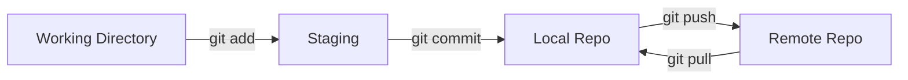
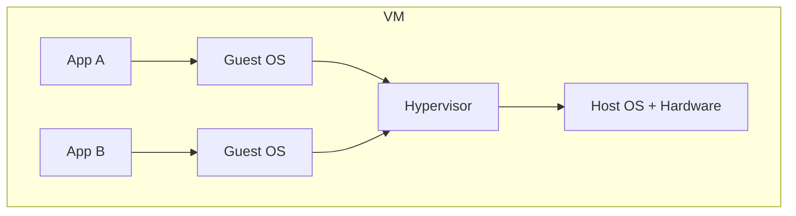
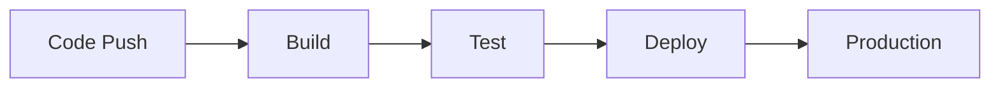

# Dev Tools & Cloud Basics

Defend resume keywords: Git, Docker, AWS, CI/CD, Linux. One-liner depth — enough for interview Q&A.

---

## Part 1: Git



| Command | Purpose |
|---------|---------|
| `git clone <url>` | Copy remote repo locally |
| `git status` | See changed files |
| `git add .` | Stage all changes |
| `git commit -m "msg"` | Save snapshot locally |
| `git push` | Upload to remote |
| `git pull` | Fetch + merge remote changes |
| `git branch <name>` | Create branch |
| `git checkout -b <name>` | Create and switch branch |
| `git merge <branch>` | Merge branch into current |
| `git log --oneline` | Commit history |

### Merge vs Rebase

| | Merge | Rebase |
|-|-------|--------|
| History | Preserves branch structure | Linear history |
| Risk | Merge commits | Rewrites history — avoid on shared branches |

### Common Interview Questions

**Q: git merge vs rebase?** — Merge combines histories; rebase replays commits on top of target.

**Q: Merge conflict?** — Same lines edited in two branches; manually resolve, `git add`, commit.

**Q: `.gitignore`?** — Files Git should not track (`.env`, `node_modules/`, build artifacts).

---

## Part 2: Docker

### Container vs Virtual Machine



| | VM | Container |
|-|----|-----------|
| OS | Full guest OS each | Shares host OS kernel |
| Startup | Minutes | Seconds |
| Size | GBs | MBs |
| Isolation | Strong | Process-level |

### Docker Concepts

| Term | Meaning |
|------|---------|
| **Image** | Read-only template (recipe) |
| **Container** | Running instance of image |
| **Dockerfile** | Script to build image |
| **Registry** | Store images (Docker Hub) |
| **Volume** | Persistent storage outside container |

```dockerfile
# Minimal Dockerfile
FROM python:3.11-slim
WORKDIR /app
COPY requirements.txt .
RUN pip install -r requirements.txt
COPY . .
CMD ["python", "app.py"]
```

**Commands:** `docker build -t myapp .` | `docker run -p 8080:8080 myapp` | `docker ps`

---

## Part 3: Kubernetes (Conceptual)

**Problem Docker alone doesn't solve:** orchestrate 100 containers across 10 machines.

| K8s Object | Role |
|------------|------|
| **Pod** | Smallest unit — one or more containers |
| **Deployment** | Manages replica pods, rolling updates |
| **Service** | Stable network endpoint for pods |
| **Ingress** | External HTTP routing into cluster |

**One-liner:** Kubernetes automates deploy, scale, and heal containers across a cluster.

---

## Part 4: AWS Basics

| Service | Purpose | Analogy |
|---------|---------|---------|
| **EC2** | Virtual servers | Rent a computer in cloud |
| **S3** | Object storage | Infinite file bucket |
| **RDS** | Managed SQL database | MySQL/PostgreSQL hosted |
| **Lambda** | Serverless functions | Run code without managing servers |
| **VPC** | Private network | Your isolated cloud LAN |
| **IAM** | Access control | Who can do what |
| **CloudFront** | CDN | Cache content globally |

### Common Questions

**Q: S3 vs EBS?** — S3 = object storage (files, images); EBS = block storage attached to EC2 (OS disk).

**Q: What is serverless?** — Provider runs your code on demand; pay per invocation; no server management.

**Q: Region vs Availability Zone?** — Region = geographic area; AZ = isolated data center within region (for redundancy).

---

## Part 5: CI/CD



| Term | Meaning |
|------|---------|
| **CI** (Continuous Integration) | Auto build + test on every commit |
| **CD** (Continuous Delivery/Deployment) | Auto deploy to staging/production |
| **Pipeline** | Automated sequence of build steps |

**Tools:** GitHub Actions, Jenkins, GitLab CI, CircleCI.

**Example pipeline:** lint → unit tests → build Docker image → deploy to staging → manual approve → deploy prod.

---

## Part 6: Linux Basics

| Command | Purpose |
|---------|---------|
| `ls -la` | List files (detailed) |
| `cd`, `pwd` | Navigate directories |
| `grep pattern file` | Search text |
| `chmod +x script.sh` | Make executable |
| `ps aux` | Running processes |
| `kill -9 <pid>` | Force kill process |
| `curl -X GET url` | HTTP request from terminal |
| `ssh user@host` | Remote login |
| `scp file user@host:/path` | Copy file over SSH |

**Permissions:** `rwx` for owner / group / others (e.g. `chmod 755`).

---

## Part 7: API & Testing (Resume Defense)

| Term | One-liner |
|------|-----------|
| **REST** | Stateless HTTP API using resources + verbs |
| **Unit test** | Test one function in isolation |
| **Integration test** | Test components working together |
| **Mock** | Fake dependency for testing |
| **Postman** | Manual API testing tool |

---

## Resume Keyword Checklist

If on resume, must explain in 2 sentences:

- [ ] Git / GitHub
- [ ] Docker
- [ ] AWS (which services?)
- [ ] CI/CD (which tool?)
- [ ] Linux / Bash
- [ ] Kubernetes (even "basic understanding")

[← Back to index](../README.md)
