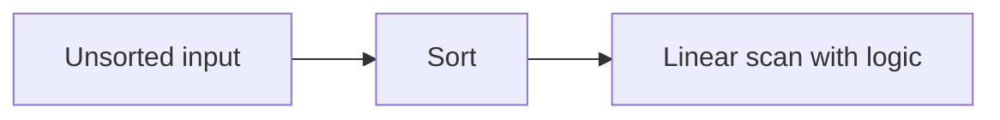

# Arrays & Hash Maps — Quick Revision

## When to Use a Hash Map

| Problem signal | Map stores |
|----------------|------------|
| "Find pair with sum X" | Value → index |
| "Count occurrences" | Element → count |
| "Check if seen before" | Element → true |
| "Group by key" | Key → list of items |

---

## Hash Table Internals

```
key → hash(key) → bucket index
Collision → multiple keys in same bucket
```

| Collision handling | How |
|--------------------|-----|
| **Chaining** | Linked list (or tree) at each bucket |
| **Open addressing** | Probe next slot (linear/quadratic probing) |

| Term | Meaning |
|------|---------|
| **Load factor** | entries / buckets (rehash when exceeds ~0.75) |
| **Rehashing** | Expand table, redistribute entries |
| **Average case** | O(1) get / put / delete |
| **Worst case** | O(n) if all keys collide |

**Interview Q: "How does HashMap work?"**  
Hash function maps key to bucket; handle collisions with chaining; rehash when load factor too high.

---

## 1. Two Sum

```
ALGORITHM TwoSum(nums, target)
INPUT : array nums, integer target
OUTPUT: indices [i, j] such that nums[i] + nums[j] = target

BEGIN
    seen ← empty map: value → index

    FOR i ← 0 TO LENGTH(nums) − 1 DO
        complement ← target − nums[i]

        IF complement IN seen THEN
            RETURN [seen[complement], i]
        END IF

        seen[nums[i]] ← i
    END FOR

    RETURN no solution
END
```

**Time:** O(n) &nbsp; **Space:** O(n)

---

## 2. Two Pointers (Sorted Array)

```
ALGORITHM TwoSumSorted(nums, target)
PRECONDITION: nums is sorted ascending

BEGIN
    left ← 0
    right ← LENGTH(nums) − 1

    WHILE left < right DO
        sum ← nums[left] + nums[right]

        IF sum = target THEN RETURN [left, right]
        ELSE IF sum < target THEN left ← left + 1
        ELSE right ← right − 1
        END IF
    END WHILE

    RETURN no solution
END
```

**Time:** O(n) after sort → O(n log n) total

---

## 3. Kadane's Algorithm (Maximum Subarray Sum)

```
ALGORITHM MaxSubArray(nums)
INPUT : array of integers (may include negatives)
OUTPUT: maximum sum of any contiguous subarray

BEGIN
    maxEnding ← nums[0]
    maxSoFar  ← nums[0]

    FOR i ← 1 TO LENGTH(nums) − 1 DO
        maxEnding ← MAX(nums[i], maxEnding + nums[i])
        maxSoFar  ← MAX(maxSoFar, maxEnding)
    END FOR

    RETURN maxSoFar
END
```

**Time:** O(n) &nbsp; **Space:** O(1)

---

## 4. Merge Intervals (Sort + Scan)

```
ALGORITHM MergeIntervals(intervals)
INPUT : list of [start, end] pairs
OUTPUT: merged non-overlapping intervals

BEGIN
    IF intervals IS EMPTY THEN RETURN [] END IF

    SORT intervals BY start time
    merged ← [intervals[0]]

    FOR i ← 1 TO LENGTH(intervals) − 1 DO
        last ← merged[LAST]
        curr ← intervals[i]

        IF curr.start ≤ last.end THEN
            last.end ← MAX(last.end, curr.end)    // overlap → merge
        ELSE
            APPEND(merged, curr)
        END IF
    END FOR

    RETURN merged
END
```

**Time:** O(n log n) &nbsp; **Space:** O(n)

---

## 5. Prefix Sum (Range Sum)

```
// Build prefix array once
ALGORITHM BuildPrefix(nums)
BEGIN
    prefix[0] ← 0
    FOR i ← 1 TO n DO
        prefix[i] ← prefix[i − 1] + nums[i − 1]
    END FOR
    RETURN prefix
END

// Sum of nums[i..j] inclusive = prefix[j + 1] − prefix[i]
```



## Edge Cases

- Empty array, single element
- All negatives (Kadane still works)
- Duplicate values
- Integer overflow (use long in Java/C++ if needed)

[← Back to index](../README.md)
