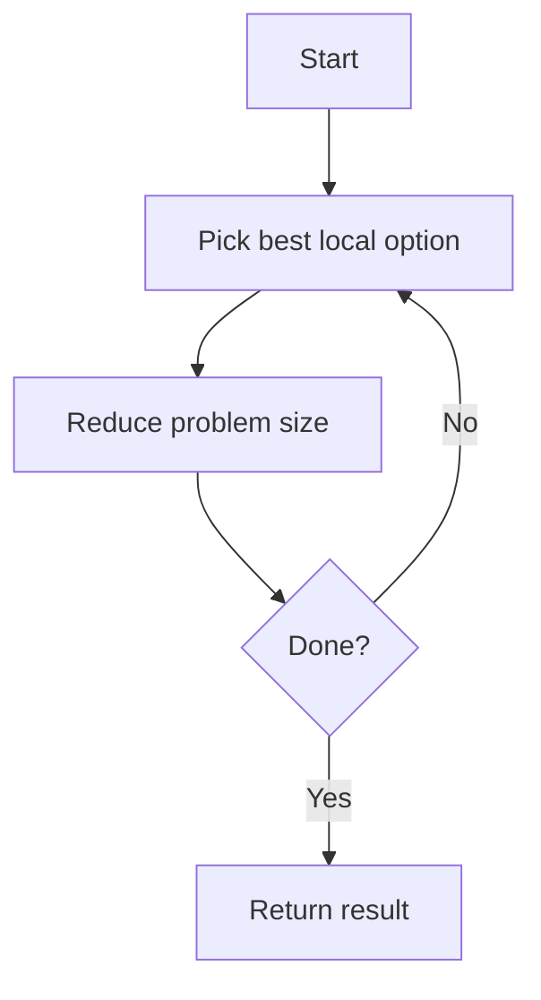

# Greedy Algorithms — Quick Revision

## Core Idea

At each step, make the **locally optimal choice** hoping it leads to a global optimum. Works when the problem has **greedy choice property** and **optimal substructure**.



---

## 1. Activity Selection / Non-overlapping Intervals

```
ALGORITHM MaxNonOverlapping(intervals)
INPUT : list of [start, end] intervals
OUTPUT: maximum count of non-overlapping intervals

BEGIN
    SORT intervals BY end time ascending

    count ← 0
    lastEnd ← −∞

    FOR EACH [start, end] IN intervals DO
        IF start ≥ lastEnd THEN        // no overlap with last picked
            count ← count + 1
            lastEnd ← end
        END IF
    END FOR

    RETURN count
END
```

**Time:** O(n log n) &nbsp; **Space:** O(1)

---

## 2. Jump Game

```
ALGORITHM CanJump(nums)
INPUT : nums[i] = max jump length from index i
OUTPUT: TRUE if last index is reachable

BEGIN
    farthest ← 0

    FOR i ← 0 TO LENGTH(nums) − 1 DO
        IF i > farthest THEN RETURN FALSE END IF   // can't reach i

        farthest ← MAX(farthest, i + nums[i])
        IF farthest ≥ LENGTH(nums) − 1 THEN RETURN TRUE END IF
    END FOR

    RETURN TRUE
END
```

**Time:** O(n) &nbsp; **Space:** O(1)

---

## 3. Assign Cookies

```
ALGORITHM FindContentChildren(g, s)
INPUT : g = greed of children, s = cookie sizes
OUTPUT: max number of content children

BEGIN
    SORT g ascending
    SORT s ascending

    child ← 0
    cookie ← 0

    WHILE child < LENGTH(g) AND cookie < LENGTH(s) DO
        IF s[cookie] ≥ g[child] THEN
            child ← child + 1           // cookie satisfies child
        END IF
        cookie ← cookie + 1
    END WHILE

    RETURN child
END
```

**Time:** O(n log n)

---

## 4. Task Scheduler / Rearrange String (Heap Greedy)

```
ALGORITHM RearrangeString(s, k)
INPUT : string s, min gap k between same chars
OUTPUT: rearranged string or empty if impossible

BEGIN
    count ← frequency map of each char
    maxHeap ← max-heap by frequency
    result ← empty string
    cooldown ← queue of (char, nextAvailableIndex)

    index ← 0
    WHILE maxHeap NOT EMPTY OR cooldown NOT EMPTY DO
        IF maxHeap NOT EMPTY THEN
            (char, freq) ← POP(maxHeap)
            APPEND(result, char)
            ENQUEUE(cooldown, (char, index + k))
            index ← index + 1
        ELSE
            index ← cooldown.front.nextAvailableIndex
        END IF

        // restore chars whose cooldown expired
        WHILE cooldown NOT EMPTY AND cooldown.front.nextAvailableIndex ≤ index DO
            (char, freq) ← DEQUEUE(cooldown)
            PUSH(maxHeap, (char, freq − 1))
        END WHILE
    END WHILE

    RETURN result
END
```

**Time:** O(n log 26) ≈ O(n)

---

## Greedy vs DP

| Greedy | Dynamic Programming |
|--------|---------------------|
| One best choice per step | Explore overlapping subproblems |
| Often O(n log n) | Often O(n²) or O(n × state) |
| Proof needed | Always works if states defined correctly |

## How to Explain in Interview

1. State why greedy works (or admit you're assuming it)
2. Sort if needed — mention why that order is correct
3. Walk through a small example
4. State complexity

[← Back to index](../README.md)
