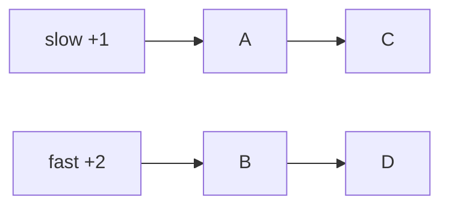

# Linked Lists — Quick Revision

## Node Structure

```
Node:
    value
    next → Node or NULL
```

## Complexity

| Operation | Singly LL | Doubly LL |
|-------------|-----------|-----------|
| Access by index | O(n) | O(n) |
| Insert at head | O(1) | O(1) |
| Delete node (given pointer) | O(1)* | O(1) |
| Search | O(n) | O(n) |

*Need previous pointer for singly — use dummy node trick.

---

## 1. Reverse Linked List

```
ALGORITHM ReverseList(head)
INPUT : head of singly linked list
OUTPUT: head of reversed list

BEGIN
    prev ← NULL
    curr ← head

    WHILE curr IS NOT NULL DO
        next ← curr.next
        curr.next ← prev
        prev ← curr
        curr ← next
    END WHILE

    RETURN prev
END
```

**Time:** O(n) &nbsp; **Space:** O(1)

---

## 2. Detect Cycle (Floyd's Algorithm)

```
ALGORITHM HasCycle(head)
OUTPUT: TRUE if cycle exists

BEGIN
    slow ← head
    fast ← head

    WHILE fast IS NOT NULL AND fast.next IS NOT NULL DO
        slow ← slow.next
        fast ← fast.next.next

        IF slow = fast THEN RETURN TRUE END IF
    END WHILE

    RETURN FALSE
END
```

**Time:** O(n) &nbsp; **Space:** O(1)



---

## 3. Merge Two Sorted Lists

```
ALGORITHM MergeTwoLists(l1, l2)
INPUT : heads of two sorted linked lists
OUTPUT: head of merged sorted list

BEGIN
    dummy ← new Node(0)
    tail ← dummy

    WHILE l1 IS NOT NULL AND l2 IS NOT NULL DO
        IF l1.value ≤ l2.value THEN
            tail.next ← l1
            l1 ← l1.next
        ELSE
            tail.next ← l2
            l2 ← l2.next
        END IF
        tail ← tail.next
    END WHILE

    tail.next ← l1 IF l1 IS NOT NULL ELSE l2
    RETURN dummy.next
END
```

**Time:** O(n + m) &nbsp; **Space:** O(1)

---

## 4. Remove Nth Node From End

```
ALGORITHM RemoveNthFromEnd(head, n)
BEGIN
    dummy ← new Node(0)
    dummy.next ← head
    fast ← dummy
    slow ← dummy

    // Move fast n+1 steps ahead
    FOR i ← 0 TO n DO
        fast ← fast.next
    END FOR

    WHILE fast IS NOT NULL DO
        fast ← fast.next
        slow ← slow.next
    END WHILE

    slow.next ← slow.next.next    // skip the nth node
    RETURN dummy.next
END
```

**Time:** O(L) where L = list length

---

## Dummy Head Pattern

```
dummy ← new Node(0)
dummy.next ← head
// ... all operations on dummy.next
RETURN dummy.next
```

Eliminates special cases when head might change.

## Interview Tip

Always check: empty list, single node, two nodes. Draw pointers on paper before coding.

[← Back to index](../README.md)
