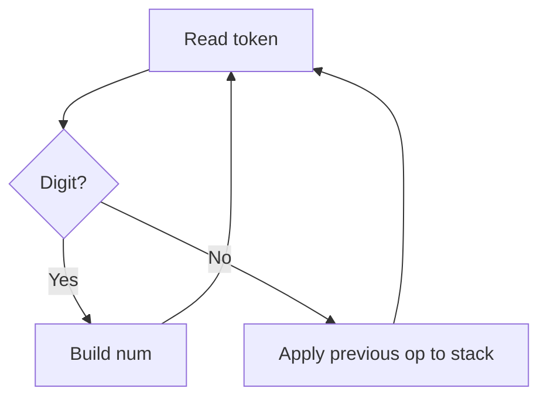

# Stacks & Queues — Quick Revision

## Stack (LIFO) | Queue (FIFO)

| Structure | Order | Key ops (O(1)) |
|-----------|-------|----------------|
| **Stack** | Last In, First Out | push, pop, peek |
| **Queue** | First In, First Out | enqueue, dequeue |

**Stack use:** brackets, DFS, expression eval, monotonic stack  
**Queue use:** BFS, scheduling, sliding window max (deque)

---

## 1. Valid Parentheses

```
ALGORITHM IsValid(s)
INPUT : string of brackets ()[]{}
OUTPUT: TRUE if properly closed and nested

BEGIN
    stack ← empty stack
    match ← map: ')'→'(', '}'→'{', ']'→'['

    FOR EACH char c IN s DO
        IF c IN match THEN                    // closing bracket
            IF stack IS EMPTY OR POP(stack) ≠ match[c] THEN
                RETURN FALSE
            END IF
        ELSE
            PUSH(stack, c)                    // opening bracket
        END IF
    END FOR

    RETURN stack IS EMPTY
END
```

**Time:** O(n) &nbsp; **Space:** O(n)

---

## 2. Evaluate Reverse Polish Notation

```
ALGORITHM EvalRPN(tokens)
INPUT : postfix expression tokens, e.g. ["2","1","+","3","*"]
OUTPUT: integer result

BEGIN
    stack ← empty stack

    FOR EACH token IN tokens DO
        IF token is operator (+, −, *, /) THEN
            b ← POP(stack)
            a ← POP(stack)
            PUSH(stack, Apply(a, b, token))
        ELSE
            PUSH(stack, toInt(token))
        END IF
    END FOR

    RETURN POP(stack)
END
```

**Time:** O(n) &nbsp; **Space:** O(n)

---

## 3. Daily Temperatures (Monotonic Stack)

```
ALGORITHM DailyTemperatures(temps)
INPUT : array of daily temperatures
OUTPUT: days to wait for warmer temp (0 if none)

BEGIN
    n ← LENGTH(temps)
    answer ← array of n zeros
    stack ← empty stack          // stores indices

    FOR i ← 0 TO n − 1 DO
        WHILE stack NOT EMPTY AND temps[i] > temps[stack.top] DO
            idx ← POP(stack)
            answer[idx] ← i − idx
        END WHILE
        PUSH(stack, i)
    END FOR

    RETURN answer
END
```

**Time:** O(n) — each index pushed/popped once

---

## 4. Basic Calculator II (BODMAS — + − * /)

```
ALGORITHM Calculate(s)
INPUT : infix expression with + − * / and spaces
OUTPUT: integer result

BEGIN
    num ← 0
    op ← '+'
    stack ← empty stack

    FOR i ← 0 TO LENGTH(s) DO
        IF i < LENGTH(s) AND isDigit(s[i]) THEN
            num ← num * 10 + digit(s[i])
        END IF

        IF (i = LENGTH(s) − 1 OR NOT isDigit(s[i])) AND i < LENGTH(s) THEN
            IF op = '+' THEN PUSH(stack, num)
            IF op = '−' THEN PUSH(stack, −num)
            IF op = '*' THEN PUSH(stack, POP(stack) * num)
            IF op = '/' THEN PUSH(stack, POP(stack) / num)   // truncate toward 0

            op ← s[i]
            num ← 0
        END IF
    END FOR

    result ← 0
    WHILE stack NOT EMPTY DO result ← result + POP(stack) END WHILE
    RETURN result
END
```



> If full code is hard — explain **operand stack + operator precedence** clearly. Pseudocode is often accepted for Hard problems.

---

## Quick Reference

| Problem type | Data structure |
|--------------|----------------|
| Matching pairs | Stack |
| Next greater/smaller | Monotonic stack |
| Level-order / shortest path | Queue (BFS) |
| Calculator / RPN | Stack |
| Sliding window max | Deque |

[← Back to index](../README.md)
