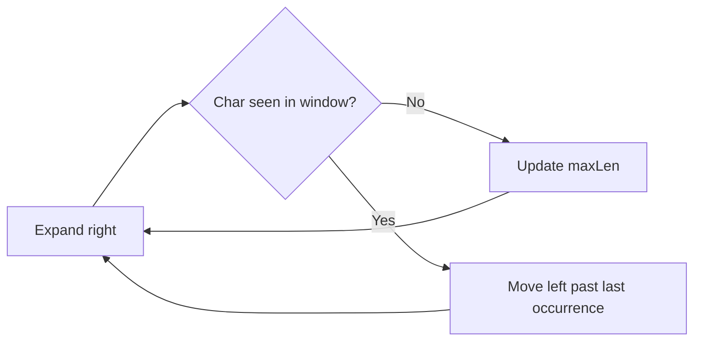

# Strings — Quick Revision

## Key Patterns

| Pattern | When to Use | Example |
|---------|-------------|---------|
| Frequency count | Anagrams, duplicates | Hash map of char → count |
| Two pointers | Palindrome, reverse | Left/right moving inward |
| Sliding window | Substring with constraint | Expand/shrink window |

---

## 1. Valid Anagram (Frequency Count)

```
ALGORITHM IsAnagram(s, t)
INPUT : two strings s and t
OUTPUT: TRUE if t is an anagram of s

BEGIN
    IF LENGTH(s) ≠ LENGTH(t) THEN RETURN FALSE END IF

    count ← array of 26 zeros          // lowercase a-z

    FOR i ← 0 TO LENGTH(s) − 1 DO
        count[s[i]] ← count[s[i]] + 1
        count[t[i]] ← count[t[i]] − 1
    END FOR

    FOR EACH c IN count DO
        IF c ≠ 0 THEN RETURN FALSE END IF
    END FOR

    RETURN TRUE
END
```

**Time:** O(n) &nbsp; **Space:** O(1) — fixed 26 slots

---

## 2. Longest Substring Without Repeating Characters (Sliding Window)

```
ALGORITHM LengthOfLongestSubstring(s)
INPUT : string s
OUTPUT: length of longest substring with all unique chars

BEGIN
    lastSeen ← empty map: char → last index
    left ← 0
    maxLen ← 0

    FOR right ← 0 TO LENGTH(s) − 1 DO
        ch ← s[right]

        IF ch IN lastSeen AND lastSeen[ch] ≥ left THEN
            left ← lastSeen[ch] + 1    // shrink window
        END IF

        lastSeen[ch] ← right
        maxLen ← MAX(maxLen, right − left + 1)
    END FOR

    RETURN maxLen
END
```

**Time:** O(n) &nbsp; **Space:** O(min(n, alphabet size))



---

## 3. Valid Palindrome (Two Pointers)

```
ALGORITHM IsPalindrome(s)
INPUT : string s (may contain non-alphanumeric)
OUTPUT: TRUE if reads same forward and backward

BEGIN
    left ← 0
    right ← LENGTH(s) − 1

    WHILE left < right DO
        WHILE left < right AND NOT isAlphaNum(s[left])  DO left ← left + 1  END WHILE
        WHILE left < right AND NOT isAlphaNum(s[right]) DO right ← right − 1 END WHILE

        IF toLower(s[left]) ≠ toLower(s[right]) THEN
            RETURN FALSE
        END IF

        left ← left + 1
        right ← right − 1
    END WHILE

    RETURN TRUE
END
```

**Time:** O(n) &nbsp; **Space:** O(1)

---

## 4. Group Anagrams

```
ALGORITHM GroupAnagrams(strs)
INPUT : array of strings
OUTPUT: groups of anagrams

BEGIN
    groups ← empty map: key → list of strings

    FOR EACH word IN strs DO
        key ← SORT(characters of word)    // or 26-char frequency signature
        APPEND(groups[key], word)
    END FOR

    RETURN all lists in groups
END
```

**Time:** O(n × k log k) where k = max word length

---

## String Builder Tip

Avoid repeated concatenation in loops (`s += c`) — use list + `''.join()` or StringBuilder (Java). Concat in loop = **O(n²)**.

## Interview Checklist

- [ ] Empty string, single char
- [ ] All same characters
- [ ] Case sensitivity (clarify!)
- [ ] Unicode / special chars (ask interviewer)

[← Back to index](../README.md)
