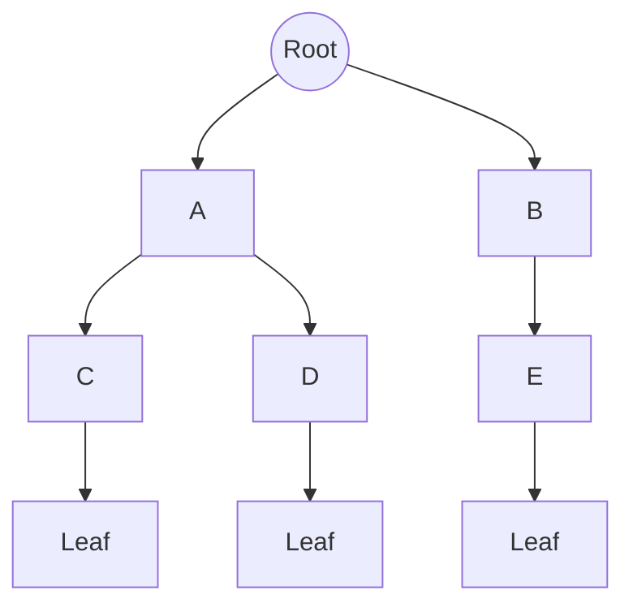
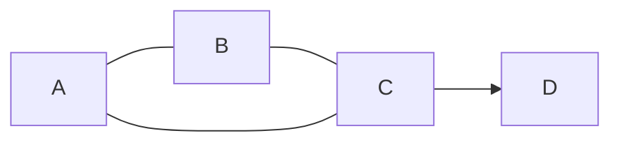
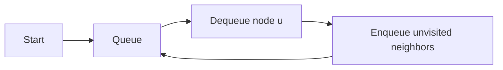

# Trees & Graphs — Quick Revision

## Part 1: Trees — Introduction

A **tree** is a hierarchical, connected structure with **no cycles**.



### Terminology

| Term | Meaning |
|------|---------|
| **Root** | Topmost node (no parent) |
| **Parent / Child** | Direct edge above / below |
| **Leaf** | Node with no children |
| **Depth** | Distance from root (root depth = 0) |
| **Height** | Longest path from node to leaf |
| **Subtree** | Node + all its descendants |

### Binary Tree

Each node has **at most 2 children** (left, right).

```
TreeNode:
    value
    left  → TreeNode or NULL
    right → TreeNode or NULL
```

### Binary Search Tree (BST)

For every node: **left subtree < node < right subtree**.

| Operation | Average | Worst (skewed) |
|-----------|---------|----------------|
| Search | O(log n) | O(n) |
| Insert | O(log n) | O(n) |
| Delete | O(log n) | O(n) |

---

## Part 2: Graphs — Introduction

A **graph** G = (V, E): **vertices (nodes)** + **edges (connections)**.



### Types

| Type | Meaning | Example |
|------|---------|---------|
| **Undirected** | Edge A—B works both ways | Social network friends |
| **Directed** | Edge A→B one way only | Web page links, dependencies |
| **Weighted** | Edge has a cost/distance | Road map |
| **Unweighted** | All edges equal | Maze, friendship graph |
| **Cyclic / Acyclic** | Has loop / no loop | DAG = Directed Acyclic Graph |

### Tree vs Graph

| | Tree | Graph |
|-|------|-------|
| Cycles | No | Can have cycles |
| Root | One fixed root | No root required |
| Edges | n−1 edges for n nodes | Any number |
| Connection | All nodes connected | Can have disconnected components |

---

## Part 3: Tree Traversals

Visit every node exactly once. Know all four.

| Traversal | Order | Common use |
|-----------|-------|------------|
| **Inorder** | Left → Node → Right | BST → sorted output |
| **Preorder** | Node → Left → Right | Copy/serialize tree |
| **Postorder** | Left → Right → Node | Delete tree, evaluate expression |
| **Level order** | Level by level (BFS) | Print each level, shortest path in tree |

### Inorder (Recursive)

```
ALGORITHM Inorder(node)
INPUT : root of binary tree
OUTPUT: visits nodes in LNR order

BEGIN
    IF node IS NULL THEN
        RETURN
    END IF

    Inorder(node.left)
    VISIT(node)          // print or append to result
    Inorder(node.right)
END
```

**Time:** O(n) &nbsp; **Space:** O(h) recursion stack, h = height

### Preorder (Recursive)

```
ALGORITHM Preorder(node)
BEGIN
    IF node IS NULL THEN RETURN END IF

    VISIT(node)
    Preorder(node.left)
    Preorder(node.right)
END
```

### Postorder (Recursive)

```
ALGORITHM Postorder(node)
BEGIN
    IF node IS NULL THEN RETURN END IF

    Postorder(node.left)
    Postorder(node.right)
    VISIT(node)
END
```

### Level Order / BFS (Iterative)

```
ALGORITHM LevelOrder(root)
INPUT : root of binary tree
OUTPUT: nodes grouped level by level

BEGIN
    IF root IS NULL THEN RETURN empty list END IF

    queue ← empty queue
    ENQUEUE(queue, root)
    result ← empty list

    WHILE queue IS NOT EMPTY DO
        levelSize ← SIZE(queue)
        currentLevel ← empty list

        FOR i ← 1 TO levelSize DO
            node ← DEQUEUE(queue)
            APPEND(currentLevel, node.value)

            IF node.left IS NOT NULL  THEN ENQUEUE(queue, node.left)  END IF
            IF node.right IS NOT NULL THEN ENQUEUE(queue, node.right) END IF
        END FOR

        APPEND(result, currentLevel)
    END WHILE

    RETURN result
END
```

**Time:** O(n) &nbsp; **Space:** O(w) where w = max width of tree

---

## Part 4: Key Tree Algorithms

### 1. Maximum Depth / Height

```
ALGORITHM MaxDepth(node)
INPUT : root node
OUTPUT: height of tree (0 if empty)

BEGIN
    IF node IS NULL THEN
        RETURN 0
    END IF

    leftDepth  ← MaxDepth(node.left)
    rightDepth ← MaxDepth(node.right)

    RETURN 1 + MAX(leftDepth, rightDepth)
END
```

**Time:** O(n) &nbsp; **Space:** O(h)

---

### 2. Search in BST

```
ALGORITHM BSTSearch(node, target)
INPUT : root of BST, target value
OUTPUT: node with target, or NULL

BEGIN
    WHILE node IS NOT NULL DO
        IF target = node.value THEN
            RETURN node
        ELSE IF target < node.value THEN
            node ← node.left
        ELSE
            node ← node.right
        END IF
    END WHILE

    RETURN NULL
END
```

**Time:** O(h)

---

### 3. Validate BST

Pass valid range down the recursion.

```
ALGORITHM IsValidBST(node, minVal, maxVal)
INPUT : node, allowed range (minVal, maxVal)
OUTPUT: TRUE if subtree is valid BST

BEGIN
    IF node IS NULL THEN RETURN TRUE END IF

    IF node.value ≤ minVal OR node.value ≥ maxVal THEN
        RETURN FALSE
    END IF

    leftOK  ← IsValidBST(node.left,  minVal,   node.value)
    rightOK ← IsValidBST(node.right, node.value, maxVal)

    RETURN leftOK AND rightOK
END

// Call: IsValidBST(root, −∞, +∞)
```

**Time:** O(n) &nbsp; **Space:** O(h)

---

### 4. Lowest Common Ancestor (LCA) — Binary Tree

```
ALGORITHM LCA(node, p, q)
INPUT : root, two target nodes p and q
OUTPUT: lowest node that has both p and q as descendants

BEGIN
    IF node IS NULL OR node = p OR node = q THEN
        RETURN node
    END IF

    left  ← LCA(node.left,  p, q)
    right ← LCA(node.right, p, q)

    IF left IS NOT NULL AND right IS NOT NULL THEN
        RETURN node          // p in one side, q in other → current is LCA
    END IF

    RETURN left IF left IS NOT NULL ELSE right
END
```

**Time:** O(n) &nbsp; **Space:** O(h)

---

### 5. Diameter of Binary Tree

Longest path between any two nodes (may not pass through root).

```
ALGORITHM Diameter(node)
OUTPUT: diameter (max edges on longest path)

BEGIN
    global best ← 0

    FUNCTION Depth(n):
        IF n IS NULL THEN RETURN 0 END IF
        left  ← Depth(n.left)
        right ← Depth(n.right)
        best ← MAX(best, left + right)    // path through this node
        RETURN 1 + MAX(left, right)
    END FUNCTION

    Depth(node)
    RETURN best
END
```

**Time:** O(n)

---

## Part 5: Graph Representation

### Adjacency List (preferred in interviews)

```
Graph with 4 nodes (0..3), edges: 0—1, 0—2, 1—3

adj ← array of lists:
    adj[0] = [1, 2]
    adj[1] = [0, 3]
    adj[2] = [0]
    adj[3] = [1]
```

| Representation | Space | Check edge u→v |
|----------------|-------|----------------|
| Adjacency list | O(V + E) | O(degree(u)) |
| Adjacency matrix | O(V²) | O(1) |

### Build from Edge List

```
ALGORITHM BuildGraph(n, edges, directed)
INPUT : n nodes, list of (u, v) pairs
OUTPUT: adjacency list adj[0..n−1]

BEGIN
    adj ← array of n empty lists

    FOR EACH (u, v) IN edges DO
        APPEND(adj[u], v)
        IF NOT directed THEN
            APPEND(adj[v], u)
        END IF
    END FOR

    RETURN adj
END
```

---

## Part 6: Graph BFS

**Use for:** shortest path in **unweighted** graph, level-by-level exploration.

```
ALGORITHM BFS(start, adj)
INPUT : start node, adjacency list
OUTPUT: dist[] (distance from start), visited order

BEGIN
    n ← number of nodes
    visited ← array of n, all FALSE
    dist    ← array of n, all −1
    queue   ← empty queue

    visited[start] ← TRUE
    dist[start]    ← 0
    ENQUEUE(queue, start)

    WHILE queue IS NOT EMPTY DO
        u ← DEQUEUE(queue)

        FOR EACH v IN adj[u] DO
            IF NOT visited[v] THEN
                visited[v] ← TRUE
                dist[v]    ← dist[u] + 1
                ENQUEUE(queue, v)
            END IF
        END FOR
    END WHILE

    RETURN dist
END
```

**Time:** O(V + E) &nbsp; **Space:** O(V)



---

## Part 7: Graph DFS

**Use for:** connectivity, path finding, cycle detection, topological sort.

### Recursive DFS

```
ALGORITHM DFS(u, adj, visited)
BEGIN
    visited[u] ← TRUE
    VISIT(u)

    FOR EACH v IN adj[u] DO
        IF NOT visited[v] THEN
            DFS(v, adj, visited)
        END IF
    END FOR
END

// Full graph (multiple components):
FOR each node i DO
    IF NOT visited[i] THEN DFS(i, adj, visited)
END FOR
```

**Time:** O(V + E) &nbsp; **Space:** O(V)

### Iterative DFS (Stack)

```
ALGORITHM DFSIterative(start, adj)
BEGIN
    visited ← all FALSE
    stack   ← empty stack
    PUSH(stack, start)

    WHILE stack IS NOT EMPTY DO
        u ← POP(stack)
        IF visited[u] THEN CONTINUE END IF

        visited[u] ← TRUE
        VISIT(u)

        FOR EACH v IN adj[u] DO          // push neighbors
            IF NOT visited[v] THEN
                PUSH(stack, v)
            END IF
        END FOR
    END WHILE
END
```

---

## Part 8: Cycle Detection

### Undirected Graph — DFS with parent

```
ALGORITHM HasCycleUndirected(u, parent, adj, visited)
BEGIN
    visited[u] ← TRUE

    FOR EACH v IN adj[u] DO
        IF NOT visited[v] THEN
            IF HasCycleUndirected(v, u, adj, visited) THEN
                RETURN TRUE
            END IF
        ELSE IF v ≠ parent THEN       // back edge to non-parent
            RETURN TRUE
        END IF
    END FOR

    RETURN FALSE
END
```

### Directed Graph — 3-color DFS

```
States: WHITE (unvisited), GRAY (in current path), BLACK (done)

ALGORITHM HasCycleDirected(u, adj, color)
BEGIN
    color[u] ← GRAY

    FOR EACH v IN adj[u] DO
        IF color[v] = GRAY THEN         // back edge → cycle
            RETURN TRUE
        END IF
        IF color[v] = WHITE AND HasCycleDirected(v, adj, color) THEN
            RETURN TRUE
        END IF
    END FOR

    color[u] ← BLACK
    RETURN FALSE
END
```

---

## Part 9: Number of Islands (Grid BFS/DFS)

Grid = implicit graph; each `1` cell is land.

```
ALGORITHM NumIslands(grid)
INPUT : 2D grid of '0' (water) and '1' (land)
OUTPUT: count of connected land components

BEGIN
    rows ← number of rows
    cols ← number of columns
    count ← 0

    FUNCTION Explore(r, c):
        IF r < 0 OR r ≥ rows OR c < 0 OR c ≥ cols THEN RETURN END IF
        IF grid[r][c] = '0' THEN RETURN END IF

        grid[r][c] ← '0'              // mark visited (sink island)

        Explore(r + 1, c)
        Explore(r − 1, c)
        Explore(r, c + 1)
        Explore(r, c − 1)
    END FUNCTION

    FOR r ← 0 TO rows − 1 DO
        FOR c ← 0 TO cols − 1 DO
            IF grid[r][c] = '1' THEN
                count ← count + 1
                Explore(r, c)
            END IF
        END FOR
    END FOR

    RETURN count
END
```

**Time:** O(rows × cols) &nbsp; **Space:** O(rows × cols) worst-case recursion

---

## Part 10: Shortest Path — Dijkstra (Weighted, Bonus)

For **non-negative** edge weights only.

```
ALGORITHM Dijkstra(start, adj, n)
INPUT : start node, adj[u] = list of (v, weight), n nodes
OUTPUT: dist[] shortest distance from start

BEGIN
    dist ← array of n, all ∞
    dist[start] ← 0
    minHeap ← priority queue ordered by dist, insert (0, start)

    WHILE minHeap IS NOT EMPTY DO
        (d, u) ← EXTRACT-MIN(minHeap)
        IF d > dist[u] THEN CONTINUE END IF   // stale entry

        FOR EACH (v, w) IN adj[u] DO
            IF dist[u] + w < dist[v] THEN
                dist[v] ← dist[u] + w
                INSERT(minHeap, (dist[v], v))
            END IF
        END FOR
    END WHILE

    RETURN dist
END
```

**Time:** O((V + E) log V) with binary heap

> **Fresher tip:** BFS + DFS + tree traversals cover most interviews. Dijkstra is a bonus.

---

## Complexity Summary

| Algorithm | Time | Space |
|-----------|------|-------|
| Tree traversals | O(n) | O(h) |
| BST search | O(h) | O(1) |
| BFS / DFS (graph) | O(V + E) | O(V) |
| Num Islands | O(R × C) | O(R × C) |
| Dijkstra | O((V+E) log V) | O(V) |

## Must-Know for Interviews

- [ ] Draw a tree; label root, leaf, depth, height
- [ ] Write inorder / level-order from memory
- [ ] Explain BFS vs DFS — when to use which
- [ ] Code MaxDepth and BST Search
- [ ] Solve Number of Islands (grid DFS/BFS)

[← Back to index](../README.md)
