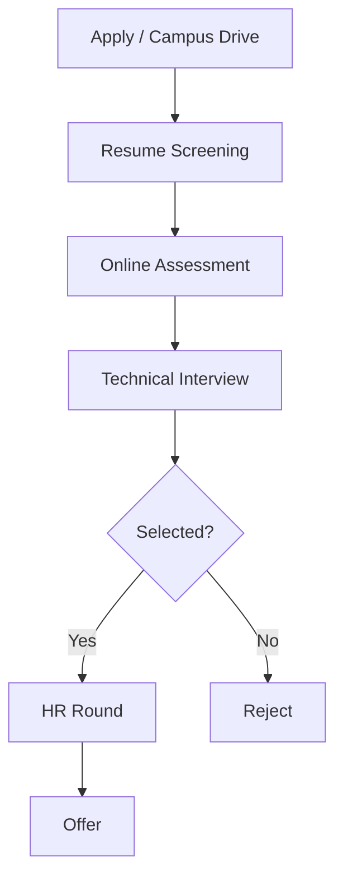
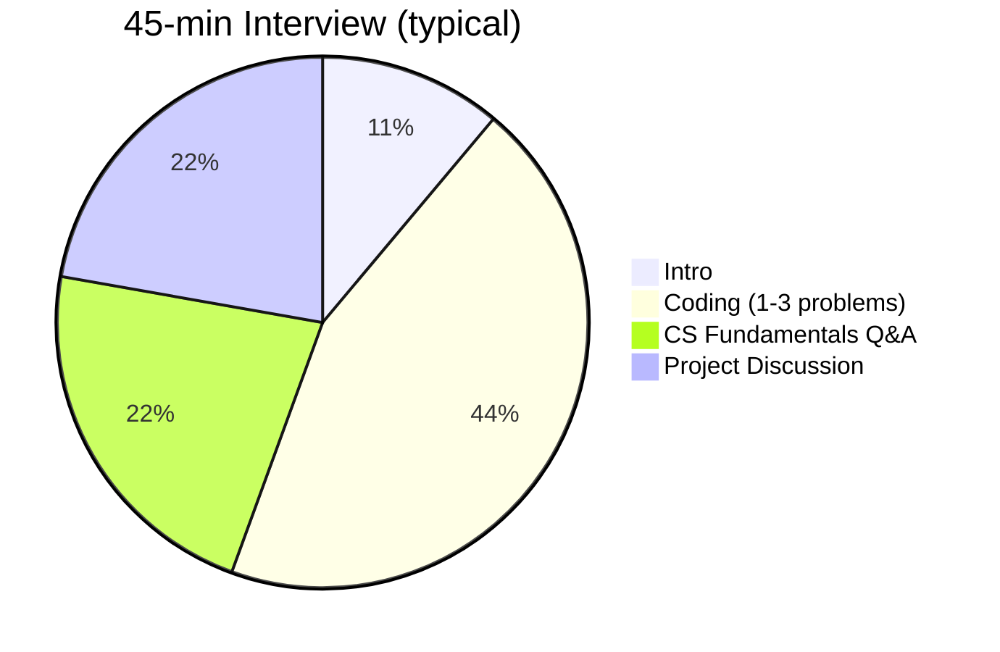

# Interview Overview

## Typical Selection Process

| Round | Duration | Focus |
|-------|----------|-------|
| Online Assessment | 60–90 min | Aptitude, CS MCQs, sometimes 1 coding problem |
| Technical (F2F / Virtual) | 30–45 min | DSA, fundamentals, projects |
| HR | 15–20 min | Fit, location, expectations |

## What Interviewers Evaluate

1. **Problem-solving** — approach before code, handle edge cases
2. **CS fundamentals** — DSA, OOP, OS, DBMS, networking
3. **Project depth** — architecture, your contribution, trade-offs
4. **Communication** — think aloud, accept hints gracefully

## Common Technical Round Structure

## Difficulty Expectations (Fresher / New Grad)

| Area | Level |
|------|-------|
| DSA | Easy to Medium (occasionally Hard pseudocode) |
| SQL | Basic joins, aggregation, subqueries |
| OS / CN / DBMS | Conceptual + 1-line examples |
| System Design | Rare for fresher; know basics only |

## Red Flags to Avoid

- Going silent while coding
- Buzzwords on resume you can't explain
- Jumping to code without stating approach
- Arguing with the interviewer
- "I don't know" with no follow-up — say what you'd try instead

## Green Flags

- Clarify constraints before coding
- Start with brute force, then optimize
- State time/space complexity
- Test with an example after writing code
- Ask 1 thoughtful question at the end

[← Back to index](../README.md)
