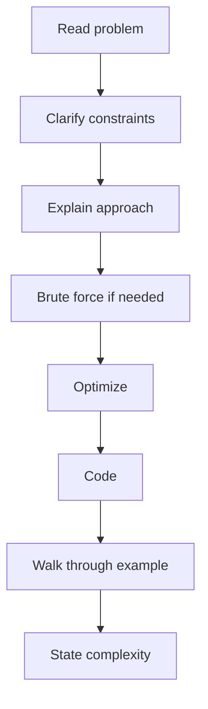

# Interview Tips — Quick Revision

## Before the Interview

- [ ] Test camera/mic (virtual) or plan arrival (F2F)
- [ ] Resume + project notes accessible
- [ ] IDE or whiteboard ready — know your language
- [ ] 2-min intro rehearsed
- [ ] 1 question prepared for interviewer

## 2-Minute Self Intro Structure

```
1. Name, college, branch, year
2. One line on focus (e.g., backend, full-stack)
3. Strongest project — one sentence
4. Why this role / company type
5. Close: "Happy to dive into technical questions"
```

## During Coding



### Do

- Think aloud — silence is the biggest mistake
- Start with brute force: "We can do O(n²) first, then optimize"
- Write clean variable names
- Test with example: normal, empty, edge
- Say time and space complexity when done

### Don't

- Code immediately without approach
- Ignore hints — they want you to succeed
- Argue if wrong — acknowledge, fix, move on
- Fake knowledge — "I'm not sure, but I'd approach it by..."

## When Stuck

1. Restate the problem in your words
2. Work a small example by hand
3. Name a pattern: "This feels like sliding window"
4. Ask: "Can I assume sorted input?" or "Can I use extra space?"
5. Offer partial solution or pseudocode

## Fundamentals Q&A Style

**Bad:** Long essay  
**Good:** Definition → one example → done in 30 seconds

> **Q:** What is deadlock?  
> **A:** When processes circularly wait for each other's resources. Needs mutual exclusion, hold-and-wait, no preemption, and circular wait. We prevent it with ordered locking or timeouts.

## Body Language (F2F / Camera)

- Eye contact / look at camera
- Nod when interviewer explains
- Smile at intro and close
- Sit upright, don't rush

## Questions to Ask Interviewer

Pick one — shows interest:

- "What does the team tech stack look like for new grads?"
- "How is onboarding structured for freshers?"
- "What kind of problems would I work on in the first 6 months?"

Avoid: salary/benefits in technical round.

## HR Round (If You Get There)

| Topic | Tip |
|-------|-----|
| Strengths | One real + example |
| Weakness | Real but improving |
| Why company | Research their product/domain |
| Relocation | Clear yes/no |
| Expected CTC | Know market range; be flexible as fresher |

---

## Behavioral Questions (STAR Format)

Use **STAR** for non-technical HR questions too:

| Letter | Meaning |
|--------|---------|
| **S** | Situation — when/where |
| **T** | Task — your responsibility |
| **A** | Action — what **you** did |
| **R** | Result — outcome, metric, learning |

### Common Behavioral Qs + Answer Skeleton

**"Tell me about a time you failed."**
> **S:** Course project deadline, integration broke night before demo.  
> **T:** I owned the API module.  
> **A:** Debugged 4 hours, asked teammate for pair debug, wrote post-mortem.  
> **R:** Demo had limited scope but worked; now I write integration tests first.

**"Conflict with a teammate?"**
> **S:** Disagreement on tech stack for final-year project.  
> **T:** I wanted Flask; teammate wanted Django.  
> **A:** Listed requirements, scored both, presented to team, voted.  
> **R:** Picked Flask for timeline; documented decision; no hard feelings.

**"Worked under pressure / tight deadline?"**
> **S:** Hackathon, 24 hours, MVP due.  
> **A:** Split tasks, 2-hour syncs, cut non-MVP features early.  
> **R:** Shipped working demo; won internal best UI.

**"Why should we hire you?"**
> Strong fundamentals + specific project + eager to learn + team player. Be specific, not generic.

**"Where do you see yourself in 5 years?"**
> Deep expertise in domain, contributing to meaningful products, growing technically.

**"Biggest weakness?"**
> Real weakness + active fix: "Used to avoid asking for help; now I timebox debugging to 30 min then ask."

### Behavioral Don'ts

- Don't blame others in conflict stories
- Don't say "I have no weaknesses"
- Don't memorize — adapt skeleton to your real experience

---

## Day-Before Checklist

- [ ] Revise strings, greedy, stacks (most common patterns)
- [ ] 10 flash answers: TCP vs UDP, ACID, process vs thread, 4 OOP pillars
- [ ] Project pitch once out loud
- [ ] Run [mock-interview-pack.md](mock-interview-pack.md) if not done yet
- [ ] Sleep well

## After the Interview

- Note questions you couldn't answer — revise those topics
- Send thank-you email if you have recruiter contact (optional, brief)

[← Back to index](../README.md)
