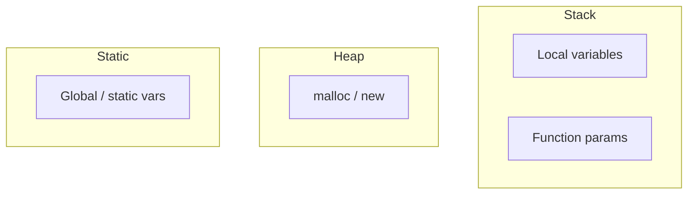

# Language Essentials — C / C++ / Java / Python

Interview Q&A for languages commonly used in campus technical rounds. Pick **one primary language** and know it deeply.

---

## C / C++

### Memory Model



| Location | Lifetime | Who manages |
|----------|----------|-------------|
| **Stack** | Function scope | Auto (compiler) |
| **Heap** | Until freed | Programmer (`free` / `delete`) |
| **Static** | Program lifetime | OS |

### Pointers vs References (C++)

| | Pointer | Reference (C++) |
|-|---------|-----------------|
| Syntax | `int *p` | `int &r` |
| Reassign | Can point elsewhere | Bound once |
| Null | Can be NULL | Must refer to valid object |
| Arithmetic | `p++` allowed | No |

### Common Interview Questions

**Q: malloc vs calloc vs new?**  
`malloc(size)` — uninitialized; `calloc(n, size)` — zero-initialized; `new` — C++ constructor called.

**Q: Memory leak?**  
Heap allocated but never freed → use RAII, smart pointers (`unique_ptr`, `shared_ptr`).

**Q: Stack overflow?**  
Too deep recursion or large local arrays on stack.

**Q: Dangling pointer?**  
Pointer to freed memory — undefined behavior.

```c
// Pointer basics
int x = 10;
int *p = &x;    // p holds address of x
*p = 20;        // x is now 20
```

---

## Java

### Collections Framework

| Interface | Implementation | Ordered? | Null? | Thread-safe? |
|-----------|----------------|----------|-------|--------------|
| List | ArrayList | Yes | Yes | No |
| List | LinkedList | Yes | Yes | No |
| Set | HashSet | No | One null | No |
| Set | TreeSet | Sorted | No | No |
| Map | HashMap | No | One null key | No |
| Map | TreeMap | Sorted keys | No null key | No |

**ArrayList vs LinkedList:**
- ArrayList — O(1) random access, O(n) insert middle
- LinkedList — O(n) access, O(1) insert at known node

### HashMap Internals (Java)

```
hash(key) → bucket index
Collision → chaining (linked list / tree in bucket if many)
Load factor 0.75 → rehash when exceeded
Average: O(1) get/put; Worst: O(n) all collide
```

### String

- **Immutable** — `"hello" + "world"` creates new object
- Use `StringBuilder` for loop concatenation
- `==` compares references; `.equals()` compares content

### Garbage Collection

- Automatic heap cleanup — objects with no references eligible for GC
- Generations: Young (Eden, Survivor) → Old gen
- **Don't** call `System.gc()` in production code

### Common Interview Questions

**Q: `==` vs `.equals()`?**  
`==` reference equality; `.equals()` value equality (override for custom classes).

**Q: Interface vs abstract class?**  
Interface — contract only (Java 8+ default methods); abstract class — shared state + partial impl.

**Q: `final`, `finally`, `finalize`?**  
`final` — constant/class/method; `finally` — always runs after try/catch; `finalize` — deprecated GC hook.

**Q: Exception checked vs unchecked?**  
Checked — must handle (IOException); unchecked — RuntimeException.

```java
// synchronized — one thread at a time
public synchronized void increment() { count++; }

// volatile — visibility across threads (not atomic for i++)
volatile boolean flag;
```

---

## Python

### Core Data Structures

| Type | Mutable? | Ordered? | Use |
|------|----------|----------|-----|
| `list` | Yes | Yes | Dynamic array |
| `tuple` | No | Yes | Immutable sequence |
| `dict` | Yes | Yes (3.7+) | Key-value map |
| `set` | Yes | No | Unique elements |

**List vs Dict lookup:** List O(n) search; dict O(1) average by key.

### Common Idioms

```python
# List comprehension
squares = [x*x for x in range(10)]

# Dict comprehension
freq = {c: s.count(c) for c in set(s)}

# Enumerate
for i, val in enumerate(nums): ...

# Zip two lists
for a, b in zip(list1, list2): ...
```

### GIL (Global Interpreter Lock)

- One thread executes Python bytecode at a time
- **I/O-bound** — threading still helps
- **CPU-bound** — use `multiprocessing`, not threads

### Common Interview Questions

**Q: List vs tuple?**  
List mutable; tuple immutable (hashable if all elements hashable).

**Q: Shallow vs deep copy?**  
`copy.copy()` — nested objects shared; `copy.deepcopy()` — full recursive copy.

**Q: `is` vs `==`?**  
`is` — same object identity; `==` — equal values.

**Q: Decorator?**  
Function wrapping another to add behavior (logging, timing, auth).

**Q: `*args` and `**kwargs`?**  
Variable positional and keyword arguments.

---

## Cross-Language Comparison

| Concept | C/C++ | Java | Python |
|---------|-------|------|--------|
| Memory mgmt | Manual / smart ptr | GC | GC |
| Typing | Static | Static | Dynamic |
| OOP | Multiple inheritance (C++) | Single inheritance | Multiple inheritance |
| Null | NULL / nullptr | null | None |
| Array size | Fixed or dynamic | ArrayList | list |

---

## Pick Your Primary Language Checklist

- [ ] Write Two Sum without looking
- [ ] Explain memory (stack/heap or GC)
- [ ] Know main collection / data structure
- [ ] String handling and immutability
- [ ] One concurrency concept (thread/GIL/synchronized)

[← Back to index](../README.md)
