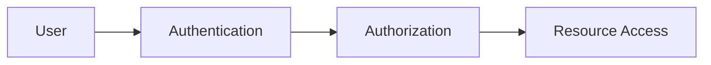
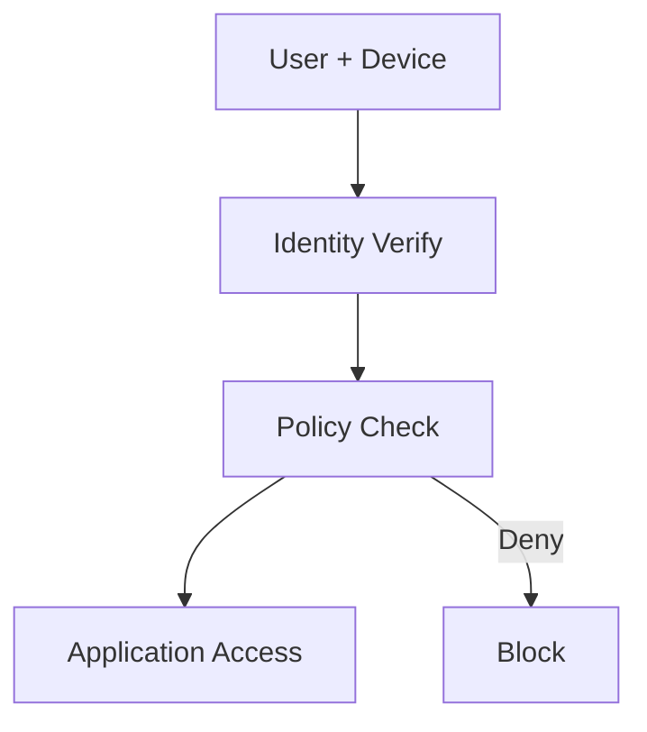

# Network & Security Basics — Quick Revision

> Useful for security/networking companies and any role involving cloud or web products.

## Core Security Concepts

| Term | One-liner |
|------|-----------|
| **Confidentiality** | Only authorized access (encryption) |
| **Integrity** | Data not tampered (hashing, signatures) |
| **Availability** | Systems accessible when needed |
| **Authentication** | Prove who you are (password, MFA) |
| **Authorization** | What you're allowed to do (RBAC) |



## Common Threats

| Threat | Description |
|--------|-------------|
| **Phishing** | Fake emails/sites steal credentials |
| **MITM** | Attacker intercepts communication |
| **DDoS** | Flood server to deny service |
| **Malware** | Virus, worm, ransomware, trojan |
| **SQL Injection** | Malicious SQL in user input |
| **XSS** | Inject script into web pages |

## Encryption

| Type | Keys | Use |
|------|------|-----|
| **Symmetric** | Same key (AES) | Bulk data encryption |
| **Asymmetric** | Public + private (RSA) | Key exchange, signatures |
| **Hashing** | One-way (SHA-256) | Password storage, integrity |

**Password storage:** Never plain text → use salted hash (bcrypt, Argon2).

## SSL/TLS & Certificates

- **Certificate Authority (CA)** signs server cert
- Browser trusts CA → trusts server
- Enables HTTPS (encrypted HTTP)

## Firewalls & Gateways

| Component | Role |
|-----------|------|
| **Firewall** | Allow/deny traffic by rules (IP, port, protocol) |
| **WAF** | Web Application Firewall — HTTP-layer protection |
| **SWG** | Secure Web Gateway — inspect/filter web traffic |
| **Proxy** | Intermediary; can inspect, cache, filter |

## Zero Trust (Modern Model)

> "Never trust, always verify."

- No implicit trust inside the network
- Verify identity + device + context for every access
- **ZTNA** replaces traditional VPN for app access



## Cloud Security Terms

| Term | Meaning |
|------|---------|
| **CASB** | Cloud Access Security Broker — visibility/control over SaaS apps |
| **DLP** | Data Loss Prevention — block sensitive data exfiltration |
| **SSE** | Security Service Edge — cloud-delivered security stack |
| **IAM** | Identity & Access Management |

## SSO & SAML (High Level)

- **SSO:** Login once, access multiple apps
- **SAML:** XML-based protocol for exchanging auth info between IdP and SP

## OWASP Top 3 (Know These)

1. Broken Access Control
2. Cryptographic Failures
3. Injection (SQL, command)

## Scenario Questions

**Q: How does HTTPS protect data on public Wi-Fi?**  
A: TLS encrypts traffic; attacker sees ciphertext, not content.

**Q: Employee uses personal hotspot to bypass corporate proxy?**  
A: Policy violation; CASB/SWG can't inspect what doesn't route through them; endpoint DLP may still help.

**Q: Difference between authentication and authorization?**  
A: AuthN = identity; AuthZ = permissions.

## What Fresher Needs

You don't need CISSP-level knowledge. Know: **CIA triad, HTTPS, firewall/proxy basics, Zero Trust idea, common attacks, auth vs authz**.

---

## Part 2: Medium & Advanced Topics

### OWASP Top 10 (Expanded — know top 5)

| # | Risk | Prevention |
|---|------|------------|
| 1 | Broken Access Control | RBAC, deny by default |
| 2 | Cryptographic Failures | TLS, strong algorithms, no hardcoded keys |
| 3 | Injection | Parameterized queries, input validation |
| 4 | Insecure Design | Threat modeling early |
| 5 | Security Misconfiguration | Harden defaults, patch, disable unused services |
| 6 | Vulnerable Components | Dependency scanning, updates |
| 7 | Auth Failures | MFA, rate limiting, secure session mgmt |
| 8 | Data Integrity Failures | Sign software, verify CI/CD pipeline |
| 9 | Logging Failures | Audit logs, monitor anomalies |
| 10 | SSRF | Validate URLs, block internal IP ranges |

### SQL Injection — Deep Dive

```sql
-- Vulnerable
query = "SELECT * FROM users WHERE name = '" + input + "'"
-- input: ' OR '1'='1  → returns all rows

-- Safe: parameterized query
SELECT * FROM users WHERE name = ?
-- driver escapes input — structure and data separated
```

### XSS Types

| Type | How | Example |
|------|-----|---------|
| **Stored** | Malicious script saved in DB | Comment with `<script>` |
| **Reflected** | Script in URL param reflected in page | Search query echoed back |
| **DOM-based** | Client-side JS processes untrusted input | `document.innerHTML = param` |

**Prevention:** Encode output, Content-Security-Policy header, sanitize input.

### CSRF (Cross-Site Request Forgery)

Attacker tricks logged-in user's browser to send unwanted request to a site where user is authenticated.

**Prevention:** CSRF tokens, SameSite cookies, verify Origin/Referer headers.

### OAuth 2.0 vs SAML (High Level)

| | OAuth 2.0 | SAML |
|-|-----------|------|
| Format | JSON, REST | XML |
| Common use | Social login, API access | Enterprise SSO |
| Flow | Authorization code, client credentials | IdP → SP assertion |

### OAuth Actors

```
Resource Owner (user) → Client (app) → Authorization Server → Resource Server (API)
```

### PKI Chain of Trust

```
Root CA → Intermediate CA → Server Certificate
Browser trusts Root → validates chain → encrypts with server's public key
```

### Security Headers (Web)

| Header | Purpose |
|--------|---------|
| `Strict-Transport-Security` | Force HTTPS |
| `Content-Security-Policy` | Restrict script/resource sources |
| `X-Frame-Options` | Prevent clickjacking |
| `X-Content-Type-Options` | Prevent MIME sniffing |

### Advanced Scenario Questions

**Q: How to store passwords securely?**  
Salt + slow hash (bcrypt/Argon2); never MD5/SHA alone for passwords.

**Q: Difference symmetric vs asymmetric in HTTPS?**  
Asymmetric (RSA/ECDH) for key exchange; symmetric (AES) for bulk data — hybrid encryption.

**Q: What is a sandbox in security context?**  
Isolated environment to run untrusted code (malware analysis, browser tabs).

**Q: Principle of least privilege?**  
Give minimum permissions needed — reduces blast radius of breach.

**Q: Difference IDS vs IPS?**  
IDS detects and alerts; IPS detects and **blocks** inline.

[← Back to index](../README.md) · [Advanced DSA →](advanced-dsa.md)

