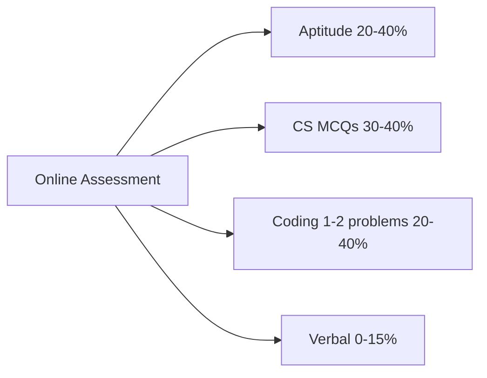

# Online Assessment (OA) Preparation

Round 1 at most campus drives — often eliminates 70–85% of candidates. Prep separately from F2F technical.



---

## Part 1: Aptitude Patterns

### Time & Work

```
If A completes work in X days, B in Y days:
Together: 1/X + 1/Y work per day
Time together: XY / (X + Y) days
```

**Example:** A = 10 days, B = 15 days → together = 6 days.

### Speed, Distance, Time

```
Speed = Distance / Time
Relative speed (opposite direction) = S1 + S2
Relative speed (same direction) = |S1 − S2|
```

### Ratios & Percentages

```
X increased by 20% → X × 1.20
X decreased by 15% → X × 0.85
Successive: 100 → +20% → 120 → −20% = 96 (not back to 100!)
```

### Profit & Loss

```
Profit% = (SP − CP) / CP × 100
Marked price with discount: SP = MP × (1 − discount%)
```

### Permutations & Combinations (Light)

```
nPr = n! / (n−r)!     — order matters
nCr = n! / (r!(n−r)!) — order doesn't matter
```

---

## Part 2: Logical Reasoning

| Type | Approach |
|------|----------|
| **Number series** | Check diff, diff-of-diff, ×, ÷ patterns |
| **Blood relations** | Draw family tree |
| **Coding-decoding** | Find letter shift or position pattern |
| **Seating arrangement** | Draw linear/circular diagram |
| **Syllogism** | Venn diagram: All A are B, Some B are C |
| **Direction** | Track N/S/E/W step by step |

**Practice:** 10–15 questions per type before any OA.

---

## Part 3: Verbal / English (If Included)

- Reading comprehension — skim questions first, then passage
- Grammar — subject-verb agreement, tenses
- Synonyms/antonyms — common academic word list
- Para jumbles — find first/last sentence, look for connectors (However, Therefore)

---

## Part 4: CS MCQ Breadth

Beyond OS/DBMS/CN (covered in other files):

| Topic | High-yield MCQ |
|-------|----------------|
| **COA** | Cache levels, pipelining, Von Neumann ([coa-basics.md](coa-basics.md)) |
| **Compiler** | Lexical → syntax → semantic → codegen; regex for tokens |
| **Digital logic** | AND/OR/NOT, flip-flops, K-map (basic) |
| **Theory of computation** | DFA vs NFA; regular vs context-free |
| **Software eng.** | SDLC phases, Agile vs Waterfall |
| **Data structures** | BST height, hash collision, graph types |

**Strategy:** If unsure, eliminate 2 wrong options first.

---

## Part 5: OA Coding Section

Usually **1–2 problems**, 45–90 min total test.

| Difficulty | Expectation |
|------------|-------------|
| Easy | 1 problem — must solve completely |
| Medium | Sometimes 1 medium OR 2 easy |
| Hard | Rare in OA; attempt partial / pseudocode |

**OA coding tips:**
- Read all problems first — pick easiest
- Pass sample test cases before optimizing
- Watch time — don't stuck 40 min on one problem
- Use language you're fastest in
- Check edge cases: empty input, n=1, negatives

See [practice-problems.md](practice-problems.md) P1 list.

---

## Part 6: Day-Before OA Checklist

- [ ] Stable internet + power backup
- [ ] Quiet environment; ID ready if proctored
- [ ] Login 10 min early
- [ ] Calculator allowed? (check rules)
- [ ] Revise aptitude formulas (above)
- [ ] Solve 2 easy coding problems as warm-up
- [ ] Don't learn new topics — revise only

---

## Sample 7-Day OA Prep Plan

| Day | Focus |
|-----|-------|
| 1 | Aptitude: time/work, speed/distance, percentages |
| 2 | Logical reasoning: series, blood relations, seating |
| 3 | CS MCQs: OS + DBMS + CN flash revision |
| 4 | CS MCQs: COA + compiler + software eng. |
| 5 | Coding P1: strings + arrays (6–10 problems) |
| 6 | Full mock OA: 30 min aptitude + 30 min CS + 45 min coding |
| 7 | Review mistakes only; light revision |

[← Back to index](../README.md) · [COA Basics →](coa-basics.md)
