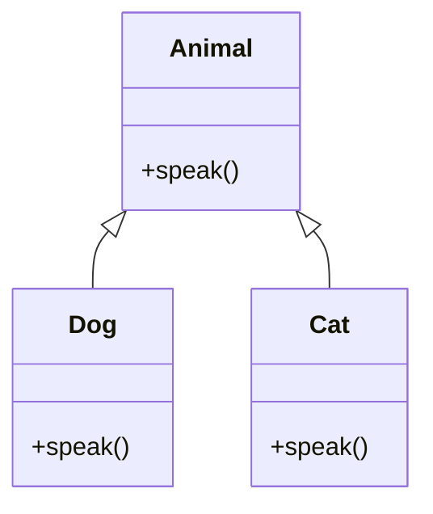

# Object-Oriented Programming — Quick Revision

## Four Pillars

| Pillar | One-liner | Example |
|--------|-----------|---------|
| **Encapsulation** | Hide data, expose via methods | Private fields + getters/setters |
| **Abstraction** | Show only what matters | Interface / abstract class |
| **Inheritance** | Reuse parent class behavior | `Dog extends Animal` |
| **Polymorphism** | Same interface, different behavior | Method overriding |



## Class vs Object

- **Class** — blueprint
- **Object** — instance in memory

## Abstract Class vs Interface

| | Abstract Class | Interface |
|-|---------------|-----------|
| Fields | Can have state | Constants only (Java ≤8) |
| Methods | Abstract + concrete | All abstract (classic) |
| Inheritance | Single (Java) | Multiple interfaces OK |
| Use when | Shared code + template | Contract / capability |

## Overloading vs Overriding

| | Overloading | Overriding |
|-|-------------|------------|
| Same name | Yes | Yes |
| Signature | Different params | Same signature |
| Where | Same class | Subclass |
| Binding | Compile time | Runtime |

## SOLID (know one line each)

| Letter | Principle |
|--------|-----------|
| **S** | Single Responsibility — one class, one job |
| **O** | Open/Closed — extend without modifying |
| **L** | Liskov Substitution — subclass usable wherever parent is |
| **I** | Interface Segregation — small focused interfaces |
| **D** | Dependency Inversion — depend on abstractions |

## Composition vs Inheritance

> **Favor composition over inheritance.**

```
Car HAS-A Engine   (composition)
Dog IS-A Animal    (inheritance — use when true "is-a")
```

## Common Interview Questions

1. Difference between abstraction and encapsulation?
2. Can constructor be private? → Yes (Singleton pattern)
3. `final` class / method / variable?
4. Static vs instance members?
5. Design a simple system: Library, Parking Lot, Logger

## Design a Logger (Quick Example)

```
Logger (interface) → log(message)
FileLogger, ConsoleLogger implement Logger
App uses Logger — doesn't care which implementation
```

## Memory Angle (C++ / Java)

- Object on **heap**, reference on **stack**
- `this` refers to current object instance

See also: [Design Patterns & LLD →](design-patterns-lld.md) · [TRAINER model answers →](../TRAINER.md)

[← Back to index](../README.md)
