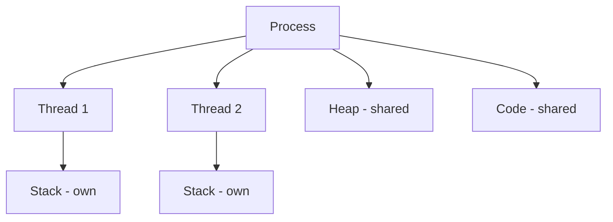

# Operating Systems — Quick Revision

## Process vs Thread

| | Process | Thread |
|-|---------|--------|
| Memory | Own address space | Shares process memory |
| Creation cost | Heavy | Light |
| Communication | IPC (pipes, sockets) | Shared memory |
| Crash | Isolated | Can crash whole process |



## Process States

```
New → Ready → Running → Waiting → Terminated
              ↑___________|
              (scheduler)
```

## CPU Scheduling (know names)

| Algorithm | Idea |
|-----------|------|
| FCFS | First come, first served |
| SJF | Shortest job first |
| Round Robin | Time slice per process |
| Priority | Highest priority first |

## Deadlock — 4 Conditions (all must hold)

1. **Mutual exclusion** — resource held exclusively
2. **Hold and wait** — holding one, waiting for another
3. **No preemption** — can't force release
4. **Circular wait** — A waits for B, B waits for A

**Prevention:** break any one condition (e.g., lock ordering breaks circular wait).

## Synchronization

| Tool | Use |
|------|-----|
| **Mutex** | One thread at a time (binary lock) |
| **Semaphore** | Counting resource access |
| **Monitor** | High-level lock + condition variables |

**Race condition:** outcome depends on thread execution order → fix with locks.

## Memory Management

| Concept | One-liner |
|---------|-----------|
| Paging | Fixed-size blocks (pages/frames) |
| Segmentation | Variable-size logical segments |
| Virtual memory | Use disk as extension of RAM |
| Page fault | Page not in RAM → OS loads it |

## Paging vs Segmentation

| Paging | Segmentation |
|--------|--------------|
| Fixed size | Variable size |
| No external fragmentation | External fragmentation possible |
| Hardware: page table | Segment table |

## Context Switch

CPU saves state of current process/thread, loads another. Has overhead.

## Common Interview Questions

1. Difference between process and thread?
2. What is deadlock? How to prevent?
3. Mutex vs semaphore?
4. What happens on page fault?
5. User mode vs kernel mode?
6. **Scenario:** Two threads increment same counter — what goes wrong? → race condition, use mutex.

## Virtual Memory Formula

```
Virtual Address Space = Physical RAM + Swap/Disk
```

---

## Part 2: Medium & Advanced Topics

### Producer–Consumer Problem

Classic IPC: bounded buffer, producers add items, consumers remove.

```
buffer[N], count, mutex, empty, full semaphores

Producer:
    wait(empty)      // block if buffer full
    wait(mutex)
    add item to buffer
    signal(mutex)
    signal(full)

Consumer:
    wait(full)       // block if buffer empty
    wait(mutex)
    remove item
    signal(mutex)
    signal(empty)
```

**Interview:** Explain why both mutex and semaphores are needed.

### Reader–Writer Problem

- Multiple readers OK simultaneously
- Writers need exclusive access
- Goal: maximize concurrency, avoid starvation

**Solution types:** Reader-priority, writer-priority, fair (using semaphores / rwlock).

### Banker's Algorithm (Deadlock Avoidance)

Before granting a resource request, OS checks if resulting state is **safe** — can all processes finish with available + allocated resources?

```
Available, Allocation[][], Need[][] = Max - Allocation
Find safe sequence where Need[i] <= Work for all i in some order
```

Not used much in practice (overhead) but common interview concept.

### Thrashing

Process spends more time paging than executing — caused by too many processes / insufficient RAM.  
**Fix:** Reduce degree of multiprogramming, add RAM, improve locality.

### TLB (Translation Lookaside Buffer)

Cache for page table entries — speeds up virtual → physical address translation.  
**TLB miss** → walk page table (slower).

### Disk Scheduling

| Algorithm | Strategy |
|-----------|----------|
| FCFS | First request first |
| SSTF | Shortest seek time first (can starve) |
| SCAN / Elevator | Move in one direction, serve, reverse |
| C-SCAN | Circular SCAN — uniform wait |

### User Mode vs Kernel Mode

| | User mode | Kernel mode |
|-|-----------|-------------|
| Privilege | Restricted | Full hardware access |
| Crash | Process dies | Can crash OS |
| Entry | System calls, interrupts | — |

**System call:** User program requests OS service (read file, fork process) — mode switch to kernel.

### Advanced Interview Scenarios

| Scenario | Answer direction |
|----------|------------------|
| Two threads increment `count++` | Race condition — not atomic; use mutex/atomic |
| Priority inversion | Low-priority holds lock high-priority needs → use priority inheritance |
| Page fault during execution | MMU traps → OS finds page on disk or kills process |
| Difference mutex vs spinlock | Spinlock busy-waits (short critical section); mutex sleeps |

[← Back to index](../README.md) · [Advanced DSA →](advanced-dsa.md)

