# Practice Problems — Quick Revision

Curated for **fresher / new-grad** technical interviews — product companies, security/networking firms, enterprise SaaS, campus drives.

## Priority Legend

| Priority | Meaning |
|----------|---------|
| **P1** | Must solve before interview |
| **P2** | Medium — strongly recommended |
| **P3** | Hard / stretch — differentiates top candidates |

---

## Strings (P1)

| # | Problem | Pattern | Difficulty |
|---|---------|---------|------------|
| 1 | Valid Anagram | Frequency count | Easy |
| 2 | Group Anagrams | Hash map + sort key | Medium |
| 3 | Longest Substring Without Repeating Characters | Sliding window | Medium |
| 4 | Valid Palindrome | Two pointers | Easy |
| 5 | First Unique Character in String | Frequency count | Easy |

### Strings (P2–P3)

| # | Problem | Pattern | Difficulty |
|---|---------|---------|------------|
| 31 | Minimum Window Substring | Sliding window + freq map | Hard |
| 32 | Permutation in String | Fixed window + freq match | Medium |
| 33 | Longest Palindromic Substring | Expand around center | Medium |
| 34 | String to Integer (atoi) | Simulation | Medium |
| 35 | Encode and Decode Strings | Delimiter / length prefix | Medium |

---

## Arrays & Hash Maps (P1)

| # | Problem | Pattern | Difficulty |
|---|---------|---------|------------|
| 6 | Two Sum | Hash map | Easy |
| 7 | Contains Duplicate | Hash set | Easy |
| 8 | Best Time to Buy and Sell Stock | One pass min | Easy |
| 9 | Product of Array Except Self | Prefix/suffix | Medium |
| 10 | Merge Intervals | Sort + greedy | Medium |

### Arrays (P2–P3)

| # | Problem | Pattern | Difficulty |
|---|---------|---------|------------|
| 36 | 3Sum | Sort + two pointers | Medium |
| 37 | Container With Most Water | Two pointers | Medium |
| 38 | Trapping Rain Water | Two pointers / prefix max | Hard |
| 39 | Subarray Sum Equals K | Prefix sum + hash map | Medium |
| 40 | Find Minimum in Rotated Sorted Array | Binary search | Medium |
| 41 | Search in Rotated Sorted Array | Binary search | Medium |
| 42 | Kth Largest Element in Array | Min-heap / quickselect | Medium |

---

## Greedy (P1)

| # | Problem | Pattern | Difficulty |
|---|---------|---------|------------|
| 11 | Assign Cookies | Sort + two pointers | Easy |
| 12 | Jump Game | Greedy farthest | Medium |
| 13 | Non-overlapping Intervals | Sort by end | Medium |
| 14 | Lemonade Change | Greedy simulation | Easy |
| 15 | Task Scheduler | Greedy + heap | Medium |

### Greedy (P2–P3)

| # | Problem | Pattern | Difficulty |
|---|---------|---------|------------|
| 43 | Jump Game II | Greedy BFS-style | Medium |
| 44 | Partition Labels | Greedy last occurrence | Medium |
| 45 | Meeting Rooms II | Sort + min-heap | Medium |
| 46 | Gas Station | Greedy circuit | Medium |

---

## Stacks & Queues (P1)

| # | Problem | Pattern | Difficulty |
|---|---------|---------|------------|
| 16 | Valid Parentheses | Stack | Easy |
| 17 | Min Stack | Stack + auxiliary | Medium |
| 18 | Evaluate Reverse Polish Notation | Stack | Medium |
| 19 | Daily Temperatures | Monotonic stack | Medium |
| 20 | Basic Calculator II | Stack / expression | Medium |

### Stacks (P2–P3)

| # | Problem | Pattern | Difficulty |
|---|---------|---------|------------|
| 47 | Largest Rectangle in Histogram | Monotonic stack | Hard |
| 48 | Basic Calculator (with parens) | Stack + eval | Hard |
| 49 | Sliding Window Maximum | Deque | Hard |

---

## Linked Lists (P2)

| # | Problem | Pattern | Difficulty |
|---|---------|---------|------------|
| 21 | Reverse Linked List | Iterative | Easy |
| 22 | Merge Two Sorted Lists | Two pointers | Easy |
| 23 | Linked List Cycle | Floyd's | Easy |
| 24 | Remove Nth Node From End | Fast/slow | Medium |
| 25 | Middle of Linked List | Fast/slow | Easy |

### Linked Lists (P2–P3)

| # | Problem | Pattern | Difficulty |
|---|---------|---------|------------|
| 50 | Reorder List | Find mid + reverse + merge | Medium |
| 51 | Merge K Sorted Lists | Min-heap / divide merge | Hard |
| 52 | LRU Cache | Hash map + doubly linked list | Hard |

---

## Trees & Graphs (P2)

| # | Problem | Pattern | Difficulty |
|---|---------|---------|------------|
| 26 | Maximum Depth of Binary Tree | DFS | Easy |
| 27 | Invert Binary Tree | DFS | Easy |
| 28 | Level Order Traversal | BFS | Medium |
| 29 | Validate BST | Bounds recursion | Medium |
| 30 | Number of Islands | BFS/DFS grid | Medium |

### Trees & Graphs (P2–P3)

| # | Problem | Pattern | Difficulty |
|---|---------|---------|------------|
| 53 | Binary Tree Level Order Traversal II | BFS reverse | Medium |
| 54 | Construct BST from Preorder | Recursion + bounds | Medium |
| 55 | Kth Smallest in BST | Inorder | Medium |
| 56 | Lowest Common Ancestor | Recursion | Medium |
| 57 | Course Schedule | Topological sort | Medium |
| 58 | Word Search | Backtracking grid DFS | Medium |
| 59 | Clone Graph | BFS/DFS + hash map | Medium |
| 60 | Network Delay Time | Dijkstra | Medium |

---

## SQL Drills

### Easy (P1)

| # | Exercise |
|---|----------|
| 1 | Second highest salary |
| 2 | Count employees per department (`HAVING`) |
| 3 | INNER JOIN two tables, filter by condition |
| 4 | Find duplicate emails |
| 5 | DELETE duplicates keeping lowest id |

### Medium (P2)

| # | Exercise |
|---|----------|
| 6 | Nth highest salary (`LIMIT OFFSET` or subquery) |
| 7 | Employees earning more than their manager (self-join) |
| 8 | Departments with no employees (`LEFT JOIN` + `IS NULL`) |
| 9 | Top 3 salaries per department (`DENSE_RANK` / CTE) |
| 10 | Customers who never ordered (`NOT EXISTS`) |
| 11 | Above department average salary (correlated subquery) |
| 12 | Monthly order count with `GROUP BY` + `ORDER BY` |
| 13 | Pivot male/female count per dept (`CASE` + `GROUP BY`) |

### Hard (P3)

| # | Exercise |
|---|----------|
| 14 | Consecutive login days (window + group trick) |
| 15 | Running total with `SUM() OVER (ORDER BY ...)` |
| 16 | Delete duplicates safely with CTE (PostgreSQL) |
| 17 | Second highest per department (window filter) |
| 18 | Transaction scenario: explain `BEGIN/COMMIT/ROLLBACK` for bank transfer |
| 19 | Explain phantom read vs non-repeatable read with example |

See [dbms-sql.md](dbms-sql.md) for full query solutions.

---

## CS Fundamentals — Medium / Advanced Rapid Fire

### DBMS (P2)

- WHERE vs HAVING with example
- Clustered vs non-clustered index
- What is a view? A trigger?
- 4 isolation levels + which anomaly each prevents
- CAP theorem one-liner
- SQL vs NoSQL — when to pick each

### OS (P2)

- Producer–consumer problem (buffer + semaphores)
- Reader–writer problem
- What is thrashing?
- TLB purpose
- User vs kernel mode
- Banker's algorithm (avoid unsafe state)

### CN (P2)

- TCP flow control vs congestion control
- HTTP methods: GET vs POST vs PUT vs DELETE
- REST principles (stateless, resource URLs)
- What is CDN? Load balancer role?
- Subnet mask purpose (basic)
- TLS 1.2 vs 1.3 (faster handshake in 1.3 — one line)

### Security (P2)

- SQL injection + prevention (parameterized queries)
- XSS types (stored, reflected)
- CSRF — what and how to prevent
- OAuth vs SAML (high level)
- Zero Trust one paragraph

---

## Timed Mock Formats

### Standard (45 min — P1 focus)

```mermaid
gantt
    title Mock Interview - Standard
    dateFormat X
    axisFormat %M min
    section Coding
    Easy + Medium     :0, 25
    section Fundamentals
    5 rapid-fire Qs   :25, 35
    section Project
    2-min pitch       :35, 45
```

### Advanced (60 min — P2/P3 stretch)

| Block | Time | Content |
|-------|------|---------|
| Coding 1 | 15 min | Medium array/string |
| Coding 2 | 20 min | Medium tree/graph or stack |
| SQL | 10 min | Write 2 queries (JOIN + window fn) |
| Fundamentals | 10 min | DBMS txn + OS/CN scenario |
| Project | 5 min | Architecture deep-dive |

---

## Weekly Plan (Extended)

| Day | Focus |
|-----|-------|
| 1 | Strings + Arrays P1 (1–10) |
| 2 | Greedy + Stacks P1 (11–20) |
| 3 | Linked Lists + Trees P2 (21–30, 53–56) |
| 4 | DBMS easy + medium SQL (1–13) |
| 5 | Advanced DSA: sliding window, heap, DP intro |
| 6 | Graph: topo sort, islands, BFS/DFS hard |
| 7 | Timed advanced mock + weak areas |

---

## Company Profile Coverage

| Profile | P1 enough? | Add P2/P3 for edge |
|---------|--------------|---------------------|
| Standard product campus | Yes | 3Sum, course schedule, medium SQL |
| Security / networking product | Yes + CN/security P2 | Min window, txn isolation, HTTP/TLS |
| Enterprise SaaS | Yes + SQL P2 | Window functions, JOIN-heavy queries |
| Competitive shortlist | P1 + selected P3 | DP, hard stack, LRU cache |

See also: [advanced-dsa.md](advanced-dsa.md) · [solutions-python.md](solutions-python.md) · [mock-interview-pack.md](mock-interview-pack.md) · [TRAINER.md](../TRAINER.md)

[← Back to index](../README.md)
