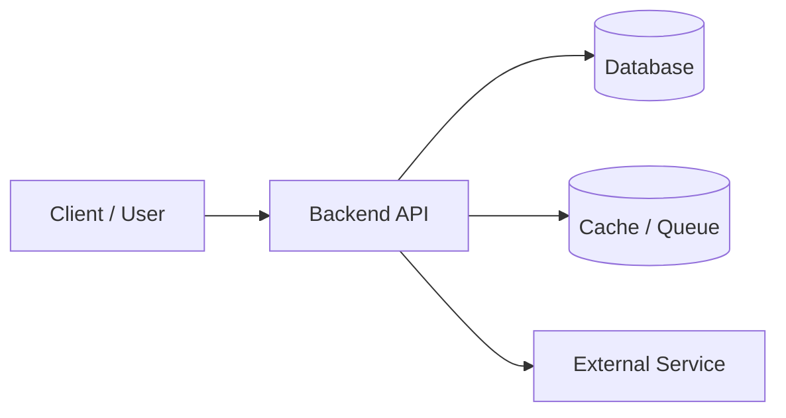

# Projects & Resume — Quick Revision

## Resume Rules

1. **One page** for students
2. Every keyword must be **defensible** in 2 sentences
3. Quantify where possible: "Reduced latency by 30%", "Handled 1K users"
4. Format: Name → Education → Skills → Projects → Experience → Achievements

## STAR Format for Projects

| Letter | What to say |
|--------|-------------|
| **S** | Situation — problem context (1 sentence) |
| **T** | Task — your specific responsibility |
| **A** | Action — tech choices, architecture, algorithms |
| **R** | Result — outcome, metrics, learnings |

## Project Explanation Template (2 min)

```
1. Problem          (15 sec)
2. Your role        (15 sec)  ← say "I" not "we"
3. Architecture     (60 sec)  ← draw if possible
4. Tech choices     (30 sec)  ← why X over Y
5. Challenge faced  (30 sec)
6. Future work      (15 sec)
```



## Architecture — Be Ready to Draw

For any web/mobile project, know:
- Frontend ↔ Backend communication (REST / GraphQL)
- Database schema (main tables, relationships)
- Auth flow (login → token → protected routes)
- Deployment (if applicable): where code runs

## Common Project Questions

1. Why did you choose this tech stack?
2. What was the hardest bug?
3. How would you scale this to 10× users?
4. What would you do differently?
5. Explain [specific keyword from resume]

## Scaling Answers (Basic — No System Design Deep Dive)

| Bottleneck | Quick fix |
|------------|-----------|
| DB reads slow | Caching (Redis), indexing |
| DB writes slow | Async queue, batch writes |
| Single server limit | Horizontal scaling + load balancer |
| Static assets | CDN |

## ML / AI Projects

Be ready to explain:
- Dataset size and source
- Model choice and why
- Metrics (accuracy, F1, loss)
- Training vs inference
- **Your contribution** — data prep? model? deployment?

## Internship Talking Points

- Team size, your tasks, tools used
- One concrete deliverable
- What you learned

## Red Flags on Resume

| Buzzword | Must know if listed |
|----------|---------------------|
| Docker | Container vs VM, basic commands |
| AWS | Which services you used (EC2, S3, Lambda) |
| React | Components, state, props, hooks basics |
| Machine Learning | Model, data, evaluation — not just library names |
| Microservices | Why split, how services communicate |

## Mock Self-Check

For each project, answer without notes:
- [ ] 30-second pitch
- [ ] Architecture diagram on paper
- [ ] One technical challenge + how you solved it
- [ ] One thing you'd improve

[← Back to index](../README.md)
