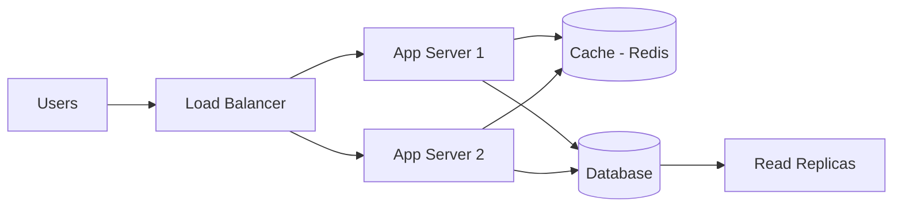

# System Design Basics (Fresher Level)

Not a full system design course — enough to answer lite questions and draw a basic architecture in 5 minutes.

---

## Part 1: Building Blocks



| Component | Role |
|-----------|------|
| **Load Balancer** | Distributes traffic across servers (Round Robin, Least Connections) |
| **App Server** | Business logic, APIs |
| **Cache (Redis)** | Fast in-memory reads; reduce DB load |
| **Database** | Persistent storage |
| **Read Replica** | Copy DB for read-heavy workloads |
| **CDN** | Static assets at edge locations |
| **Message Queue** | Async tasks (email, notifications) |

---

## Part 2: Scaling

| Type | How | Limit |
|------|-----|-------|
| **Vertical** | Bigger CPU/RAM on one machine | Hardware ceiling, single point of failure |
| **Horizontal** | Add more machines + load balancer | Preferred at scale |

**Stateless app servers** — any server handles any request (session in Redis, not local memory).

---

## Part 3: Caching Strategies

| Strategy | Behavior |
|----------|----------|
| **Cache-aside** | App checks cache → miss → read DB → write cache |
| **Write-through** | Write to cache and DB together |
| **TTL** | Cache entry expires after N seconds |

**Cache invalidation:** Hardest problem — delete/update cache when DB changes.

---

## Part 4: Database Choices

| Need | Choice |
|------|--------|
| ACID transactions, joins | SQL (PostgreSQL, MySQL) |
| Flexible schema, scale reads | MongoDB |
| Fast key-value cache | Redis |
| High write throughput | Cassandra, time-series DB |

**Read vs write heavy:**
- Read heavy → cache + read replicas
- Write heavy → sharding, async queues

---

## Part 5: Design a URL Shortener (5-Min Answer)

### Requirements
- Input long URL → output short URL
- Redirect short → long
- 100M URLs/month (mention scale)

### High-Level Design

```
Client → API Server → DB (id, longUrl, shortCode, createdAt)
                    → Cache (hot shortCode → longUrl)
                    → Counter / ID generator (auto-increment or Snowflake)
```

### Short Code Generation

| Approach | Pros | Cons |
|----------|------|------|
| Auto-increment + Base62 | Simple, unique | Predictable |
| Hash of URL | Deterministic | Collisions need handling |
| Random + check DB | Unpredictable | Retry on collision |

**Base62:** `[a-zA-Z0-9]` — encode id 125 → `"bT"`

### Estimate Storage (show thinking)

```
100M URLs × ~500 bytes ≈ 50 GB — fits one DB with indexing
```

---

## Part 6: Design Twitter Feed (Lite)

```
User posts → Write to DB → Fan-out to followers' feed cache
User reads feed → Read from pre-built feed cache (not compute on read)
```

**Fan-out on write** vs **fan-out on read** — trade-off for celebrity accounts.

---

## Part 7: CAP Theorem (One Slide)

Pick **2 of 3** in distributed systems:
- **C**onsistency — all nodes see same data
- **A**vailability — every request gets a response
- **P**artition tolerance — works despite network splits

Most distributed systems choose **AP** (eventual consistency) or **CP**.

---

## Part 8: Common Fresher Questions

| Question | Answer direction |
|----------|------------------|
| Horizontal vs vertical scaling? | Add machines vs bigger machine |
| Why cache? | Reduce latency, reduce DB load |
| SQL vs NoSQL? | ACID/joins vs scale/flexibility |
| What is a load balancer? | Distributes requests, health checks |
| REST API stateless? | Server stores no client session between requests |
| 404 vs 500? | Client error vs server error |

---

## What NOT to Do in Fresher SD Round

- Don't dive into Kafka, Kubernetes unless asked
- Don't over-engineer — start simple, mention "at scale we'd add X"
- Do draw a diagram
- Do mention cache + DB + load balancer

See [design-patterns-lld.md](design-patterns-lld.md) for class-level design.

[← Back to index](../README.md)
